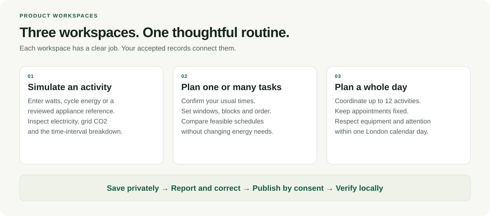
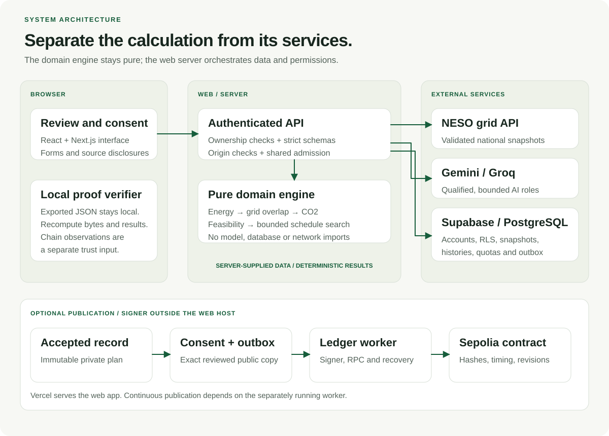
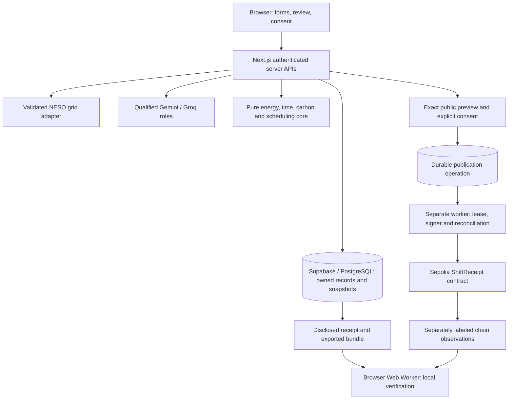
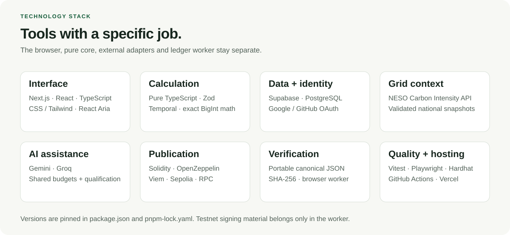
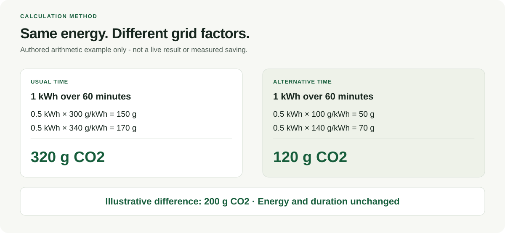
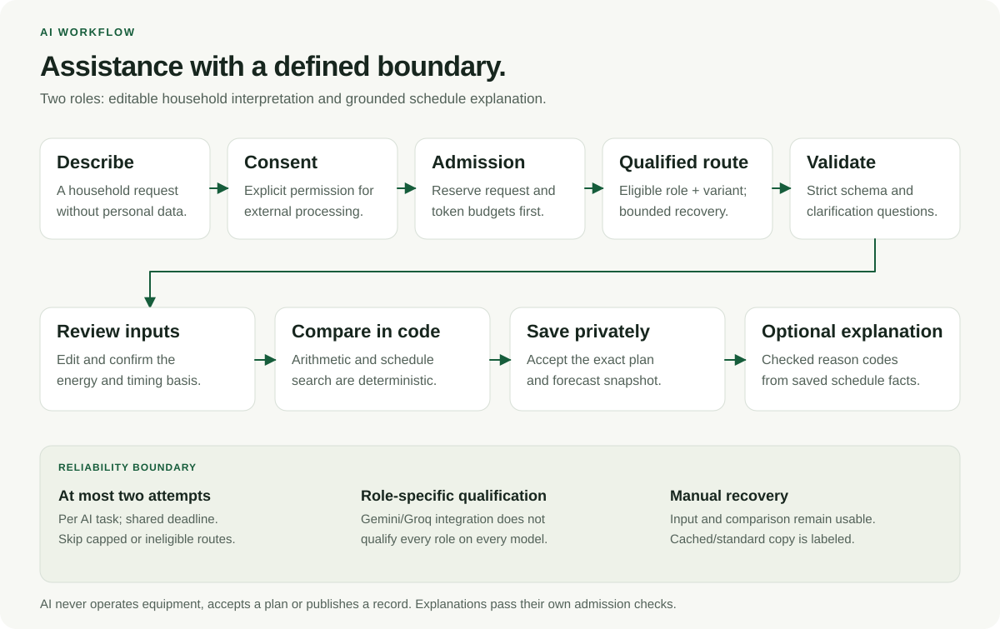
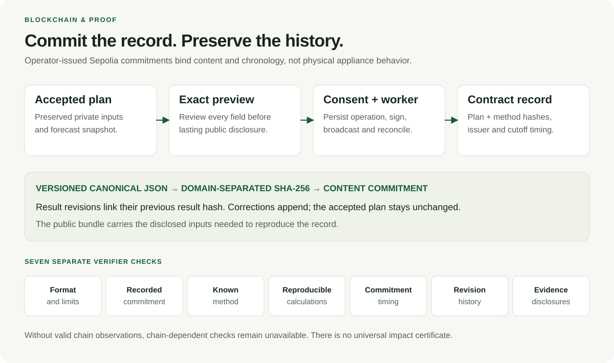
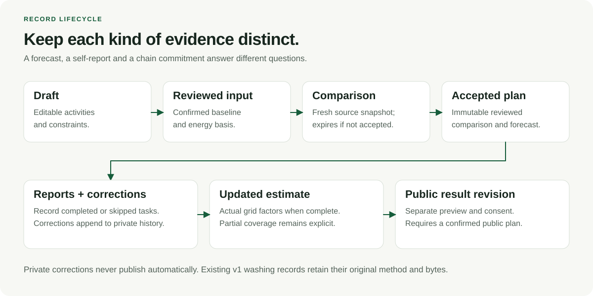

<p align="center">
  
</p>

# CarbonShift

**AI Energy Planning & Emissions Transparency**

Plan everyday electricity use around your routine, compare its estimated grid CO₂, and inspect the record behind the recommendation.

<p>
  <a href="https://github.com/z-lovejeet/CarbonShift/actions/workflows/ci.yml"></a>
  <a href=".nvmrc"></a>
  <a href="package.json"></a>
  <a href="contracts/ShiftReceipt.sol"></a>
</p>

**[Open the live app](https://carbonshift-mocha.vercel.app)** · **[Explore the example](https://carbonshift-mocha.vercel.app/demo)** · **[Inspect a confirmed receipt](https://carbonshift-mocha.vercel.app/receipts/0x7634e04b847f24d720a4a12af5ba2bc4f10334fd942b96e5a347ff2f37078f56)** · **[Verify a proof](https://carbonshift-mocha.vercel.app/verify)** · **[Read the methodology](https://carbonshift-mocha.vercel.app/methodology)**

Built for the **IEEE ClimateChain Global Hackathon**. Primary submission track: **Carbon Markets & Emissions Transparency**, through transparent electricity-emission estimates and inspectable records.

**Current scope:** Great Britain national grid signal · Europe/London scheduling · 48-hour planning horizon · up to 12 activities per schedule · experimental, optional AI assistance · optional Sepolia publication.

> CarbonShift estimates electricity and grid CO₂ from reviewed inputs. It does not measure an unknown appliance, verify physical operation, issue carbon credits or certify avoided emissions. The calculation, report and blockchain evidence remain distinct throughout the product.

---

## Contents

- [Why CarbonShift](#why-carbonshift)
- [Try the live product](#try-the-live-product)
- [Product capabilities](#product-capabilities)
- [A reproducible household scenario](#a-reproducible-household-scenario)
- [System architecture](#system-architecture)
- [Technology stack](#technology-stack)
- [Calculation and scheduling](#calculation-and-scheduling)
- [AI assistance and fallback](#ai-assistance-and-fallback)
- [Blockchain and portable verification](#blockchain-and-portable-verification)
- [Records, privacy and security](#records-privacy-and-security)
- [Run locally](#run-locally)
- [Configure connected services](#configure-connected-services)
- [API and repository map](#api-and-repository-map)
- [Checks and evidence](#checks-and-evidence)
- [Deployment and operation](#deployment-and-operation)
- [Troubleshooting](#troubleshooting)
- [Scope and next steps](#scope-and-next-steps)
- [Project documentation](#project-documentation)

## Why CarbonShift

The laundry needs washing. A floor needs cleaning. Someone needs their computer, and a family may have a fixed time to watch television together.

Those activities are familiar. The carbon-intensity data that could inform their timing is less accessible, and a low-intensity interval is only useful if it fits the person's actual day.

CarbonShift connects that everyday decision to a transparent record:

1. **Understand** the electricity implied by a confirmed device, duration and energy basis.
2. **Compare** the usual schedule with feasible alternatives using the same energy assumptions and source snapshot.
3. **Keep** the accepted plan and its original forecast unchanged.
4. **Report** what happened, including skipped activities and corrections.
5. **Inspect** a separately consented public record through an exported bundle and its blockchain commitment.

The contribution is the connected household workflow: practical constraints before a decision, reproducible accounting around it, and inspectable history afterwards. Carbon-aware scheduling and grid forecasting are established fields; CarbonShift does not claim to invent either.

## Try the live product

| Destination | What you can do | Access |
| --- | --- | --- |
| [Home](https://carbonshift-mocha.vercel.app) | Understand the project and open its workspaces | Public |
| [Example](https://carbonshift-mocha.vercel.app/demo) | Explore a clearly labeled synthetic scenario with a fixed clock | Public |
| [Simulator](https://carbonshift-mocha.vercel.app/app/simulate) | Estimate an activity's electricity and grid CO₂ | Google/GitHub sign-in |
| [Task planner](https://carbonshift-mocha.vercel.app/app/plan/new) | Compare one or several activities and available windows | Google/GitHub sign-in |
| [Day planner](https://carbonshift-mocha.vercel.app/app/day/new) | Coordinate a routine within one London calendar day | Google/GitHub sign-in |
| [Your plans](https://carbonshift-mocha.vercel.app/app) | Reopen owned schedules and their histories | Google/GitHub sign-in |
| [Confirmed public receipt](https://carbonshift-mocha.vercel.app/receipts/0x7634e04b847f24d720a4a12af5ba2bc4f10334fd942b96e5a347ff2f37078f56) | Inspect an actual published record and transaction references | Public |
| [Verifier](https://carbonshift-mocha.vercel.app/verify) | Recompute an exported proof locally in the browser | Public |
| [Methodology](https://carbonshift-mocha.vercel.app/methodology) / [Privacy](https://carbonshift-mocha.vercel.app/privacy) | Read the assumptions, boundaries and disclosures | Public |

**A short review route:** simulate a television session → compare Laundry → build the four-activity day below → save privately → inspect the confirmed public receipt → export and verify its bundle.

Normal users do not need a cryptocurrency wallet. New publication requests are processed by the separately running operator ledger worker. Its availability is separate from the Vercel web app.

## Product capabilities



### Activity simulation

- Choose an activity, active duration, quantity and start time.
- Supply operating watts, energy per cycle, or an exact reviewed appliance reference where available.
- Explicitly confirm the energy basis and its source.
- Inspect electricity, estimated grid CO₂, interval contributions, source attribution and retrieval time.
- Use forecasts for supported future activities or retrospective factors for supported completed activities.
- Carry a reviewed activity into the task planner.
- Model an explicitly confirmed activity with no direct electricity without implying no environmental impact.

### Task and whole-day planning

- Plan one activity or a routine of up to **12 activities**.
- Set usual times, one or more availability windows and blocked periods.
- Preserve fixed activities and appointments.
- Prevent overlaps involving shared equipment or continuous user attention.
- Require predecessors to finish before dependent tasks start.
- Compare the baseline with the selected feasible schedule and additional alternatives.
- Review a separate 30-minute window-extension proposal where applicable; applying it returns to unconfirmed review.
- Keep overnight task planning separate from a calendar-day routine.
- See actionable errors for past windows, insufficient time, conflicts, stale data and missing coverage.

### Accepted records and reporting

- Save the exact reviewed comparison privately with its original source snapshot.
- Report each activity as completed or skipped.
- Confirm whether its accepted energy and duration still apply.
- Refresh eligible updated estimates using retrospective grid factors.
- Append corrections and preserve report history.
- Distinguish complete, pending, changed-profile, skipped and unreported states.
- Show a covered subtotal explicitly rather than presenting it as the complete routine.

### Twelve supported activity categories

| Household appliances | Everyday devices | Cleaning and care | Other uses |
| --- | --- | --- | --- |
| Clothes washing | Television | Vacuuming | Charging |
| Dishwasher | Computer | Ironing | Custom activity |
| Tumble drying | Lighting | Car cleaning | Fan |

A category organizes the task; it does not establish the device's wattage. Car cleaning refers to the powered equipment and active electrical runtime the user actually intends to model.

## A reproducible household scenario

**Choose the date first:** let **D be tomorrow in Europe/London**, then use D in every date field. If London shows 25 October, D is 26 October even if the reviewer's device already shows 26 October. This prevents an earlier morning on today's date from becoming a past planning window.

### Start with the simulator

| Field | Illustrative input |
| --- | --- |
| Activity / name | Television / Afternoon television |
| Active duration / quantity | 120 minutes / 1 |
| Energy basis | Operating power · watts |
| Power / source | 100 W / My estimate |
| Start | D at 14:00 London time |
| Energy confirmation | Check after reviewing |

Expected input-derived electricity: **0.2 kWh**. CO₂ depends on the current factors covering that activity.

Optional AI description:

> Tomorrow in London, I want to watch television at 14:00 for 120 minutes. I will use one television, with an estimated operating power of 100 watts.

Review interpreted fields and confirm the energy basis. Manual entry reaches the same deterministic calculation path.

### Build a day with four activities

Open **Plan your day**, select **Your day = D**, then enter:

| Input | Laundry | Vacuuming | Ironing | Evening television |
| --- | --- | --- | --- | --- |
| Category | Clothes washing | Vacuuming | Ironing | Television |
| Duration | 90 min | 20 min | 30 min | 120 min |
| Quantity | 1 | 1 | 1 | 1 |
| Energy basis | Per-cycle kWh | Operating watts | Operating watts | Operating watts |
| Energy input | 0.6 kWh | 800 W | 1200 W | 100 W |
| Source | My estimate | My estimate | My estimate | My estimate |
| Usual start | 18:00 | 18:30 | 20:00 | 20:30 |
| Available from | 08:00 | 09:00 | 10:00 | 20:30 |
| Must finish by | 22:00 | 20:00 | 22:00 | 22:30 |
| Keep fixed | No | No | No | Yes |
| Needs attention throughout | No | Yes | Yes | Yes |
| Shared equipment | `washer` | `utility-socket` | `utility-socket` | Leave blank |
| Must follow | None | None | Laundry | None |

Use D for all starts and window boundaries, leave blocked periods empty, and confirm each energy basis. Review all tasks, confirm the constraints, compare, choose an option and review before saving.

The accepted electricity total is approximately **1.667 kWh**. Ironing must follow Laundry; the socket and attention constraints prevent relevant overlaps; Television stays fixed. Live factors determine whether a different feasible schedule has a lower estimate. These are **authored assumptions**, not verified specifications or measured household results.

## System architecture



The application separates three kinds of authority:

| Boundary | Owner | Responsibility |
| --- | --- | --- |
| User decision | Browser and reviewed forms | Supply assumptions, review constraints, accept a plan, report an outcome and consent to disclosure |
| Numerical decision | Pure domain modules | Resolve energy, validate time, integrate grid factors, search feasible schedules and recompute results |
| Service and record authority | Server, database and worker | Authenticate, validate sources, enforce ownership/quotas, preserve histories, process consented commitments |

**Request path:** browser → authenticated server API → validated service inputs → pure domain calculation → owned persistence → reviewed response.

**Publication path:** accepted private plan → exact public preview → explicit consent → durable operation/outbox → separately running signer → Sepolia commitment → public receipt/export.

**Verification path:** disclosed bundle → browser Web Worker → schema/method/calculation checks → separately supplied chain observations for commitment and chronology checks.

The domain does not import UI, database, AI or network code. Server-owned schemas and source adapters prevent client-supplied totals or a model's prose from becoming authoritative accounting inputs.

<details>
<summary><strong>Architecture as editable Mermaid</strong></summary>



Grid and AI adapters return validated inputs through the server; they are not dependencies imported by the pure core. Models do not sign or publish.

</details>

## Technology stack



| Area | Technology | Purpose |
| --- | --- | --- |
| Web application | Next.js 16.4.2, React 19.3.1, TypeScript | Server-rendered pages, interactive workspaces and APIs |
| Interface | CSS modules/shared CSS, Tailwind CSS, React Aria Components | Paper/forest visual system, responsive forms, calendar/time interactions |
| Input contracts | Zod 4 | Strict bounded schemas at external boundaries |
| Time and math | Temporal polyfill, integer units, BigInt rational intermediates | London/DST handling, exact integration and defined rounding |
| Data and identity | Supabase, PostgreSQL, Google/GitHub OAuth | Owned records, RLS, snapshots, histories, quotas and publication state |
| Grid context | NESO Carbon Intensity API | National forecast and retrospective factors with provenance |
| AI | Gemini and Groq adapters | Reviewed interpretation and grounded explanation |
| Contract | Solidity 0.8.37, OpenZeppelin | Operator-issued commitments and append-only result lineage |
| Chain access | Viem, Sepolia, configured RPC such as Alchemy | Contract reads, transaction submission and reconciliation |
| Portable proof | Canonical JSON, SHA-256, browser Web Worker | Consistent bytes, hashes and local recomputation |
| Quality | Vitest, Testing Library, Playwright, axe, Hardhat | Unit/component, database, contract and browser checks |
| Delivery | GitHub Actions, Vercel, separate ledger worker | CI, web deployment and explicitly operated publication |

The lockfile and [package manifest](package.json) are authoritative for installed versions. Codex was a development tool; it is separate from the Gemini/Groq providers integrated into the product.

## Calculation and scheduling



### Energy and factor integration

For a constant-power scenario:

$$
E_{\mathrm{kWh}} = \frac{P_{\mathrm{W}}\,t_{\mathrm{hours}}\,n}{1000}
$$

For a declared cycle, the per-cycle energy is multiplied by the simultaneous quantity once. Each declared segment's energy is distributed uniformly across its duration, with that assumption disclosed.

The carbon estimate integrates energy over the actual overlaps with grid intervals:

$$
C_{\mathrm{gCO_2}} = \sum_i E_{i,\mathrm{kWh}}\,I_{i,\mathrm{gCO_2/kWh}}
$$

The comparison is `usual estimate - selected estimate`, using the same accepted energy assumptions and forecast snapshot for both.

- V2 stores energy as integer **mWh** and carbon as integer **mgCO₂**.
- Decimal watts are parsed into integer mW; decimal kWh into integer mWh, with explicit precision limits.
- Exact rational contributions are accumulated before rounding to task milligrams.
- Schedule totals sum the rounded task totals; rounded display intervals do not define the authoritative total.
- A missing required factor or temporal gap makes the affected whole-task CO₂ unavailable, rather than zero.
- Retrospective source `actual` factors are estimated grid intensity derived from generation data, not measurements of the user's appliance.

### Feasibility, search and time bounds

| Rule | Household method |
| --- | --- |
| Method identifier | `carbonshift-gb-activities-v2` |
| Geography / timezone | `GB_NATIONAL` / `Europe/London` |
| Activities | Up to 12 per schedule |
| Source interval | 30 minutes |
| Candidate starts | Every 5 minutes on the UTC grid, plus relevant legal boundaries, baseline and fixed starts |
| Search budget | Up to 50,000 nodes; status distinguishes `optimal_within_candidates` and `best_found` |
| Alternatives | Up to 3 additional schedules |
| Planning horizon | 48 elapsed hours |
| Forecast maximum age | 30 minutes |
| Comparison lifetime | 5 minutes |
| Operational review buffer | At least 10 minutes before relevant starts |
| Day mode | Activities and windows stay inside the selected London day |
| Task mode | Overnight availability can fit within the supported horizon |

A task must fit wholly in an allowed window, avoid blocks, follow its predecessors and respect shared resources. The complete usual schedule must also be feasible and stays among the candidates, so the selected estimate is not worse than that baseline.

Repeated London hours require an occurrence choice; nonexistent local times are rejected. Date defaults use London, independently of the browser's timezone.

This is average grid-intensity accounting. A lower estimate is **not** a measurement of marginal avoided emissions or a guarantee of cheaper electricity. Detailed rules: [methodology](docs/08-scheduling-and-carbon-methodology.md), [energy](src/domain/activities/energy.ts), [carbon integration](src/domain/activities/carbon.ts), [constraints](src/domain/activities/constraints.ts), [scheduler](src/domain/activities/scheduler.ts).

## AI assistance and fallback



| Role | Input and output | Authority boundary |
| --- | --- | --- |
| Household interpretation | Consented description → editable activities, timing fields and clarification questions | Unknown information stays unknown; the user reviews and confirms |
| Grounded explanation | Owned immutable comparison facts → eligible reason codes and checked explanation | Numbers and conclusions come from code-owned facts |

The server uses a strict `AI_POLICY_JSON` policy and code-owned registry. A route must be qualified for its **model × role × variant**; catalog visibility or a successful access smoke is insufficient.

- Request/token capacity is reserved atomically in shared PostgreSQL buckets before dispatch.
- User/application/provider/model limits, task-key deduplication, timeouts, cooldowns and circuit behavior bound requests.
- An AI task permits **at most two actual provider attempts** within its original deadline.
- Capped, disabled and unqualified routes are skipped before a request is sent.
- Recovery within a provider or across Gemini/Groq occurs only when the next route is independently eligible.
- Explanation caching stores checked selections bound to their owner/comparison/version context, avoiding another model request on a valid hit.
- Manual entry and deterministic comparison remain available when assistance is unavailable. AI/cache/standard explanation sources are labeled.

**Recorded qualification:** Gemini's expanded interpretation passed 24 authored development cases and its grounded schedule explanation passed six scenarios. The labels were agent-reviewed at the builder's request; these are not population accuracy or an independent user study. The expanded Groq interpreter remains excluded after strict validation failures. Existing v1 Groq qualification does not automatically transfer to v2.

A bounded deployed check recorded one Gemini household interpretation, one Groq v1 explanation and cache reuse with zero extra inference. That establishes the specific access/wiring check, not a new role qualification or a successful forced fallback experiment.

See [AI policy and evidence](docs/09-ai-agents-models-and-workflow.md), [household AI evidence](research/household/final/ai-wiring.json) and [deployed AI evidence](research/release/production-ai.json). Public-provider prerequisites are listed under [scope and next steps](#scope-and-next-steps).

## Blockchain and portable verification



### Why the ledger exists

Publication binds a particular disclosed plan and its later public revisions to recorded content and chronology. A reviewer can compare an exported bundle with those commitments and reproduce the calculations.

The `ShiftReceipt` contract is **operator-issued**, guarded by ownership controls. It is not a decentralized source oracle, a token marketplace or a certificate of physical emissions savings.

### What is recorded

Public manifests are serialized consistently, then hashed with SHA-256 and a versioned domain prefix such as `CarbonShift:plan:v2`. The contract records a plan hash, method hash, timing/cutoff and issuer context. Detailed disclosed inputs remain in the portable bundle.

Contract guards reject duplicate receipt identifiers, zero digests, invalid live cutoffs, out-of-order revisions and inconsistent previous-result hashes. A separately consented result revision links its predecessor rather than overwriting it.

The worker persists signed operation state before broadcasting and reconciles canonical observations. Queued, signing, submitted, uncertain, failed and confirmed states have different meanings. An HTTP success is not a chain confirmation.

### Actual testnet evidence

| Item | Inspect |
| --- | --- |
| Network | Ethereum Sepolia · chain ID `11155111` |
| Recorded contract | [`0xddc904b894669e4f00a3b4dfbaad58f90e9f7040`](https://sepolia.etherscan.io/address/0xddc904b894669e4f00a3b4dfbaad58f90e9f7040) |
| Production public receipt | [Open the confirmed record](https://carbonshift-mocha.vercel.app/receipts/0x7634e04b847f24d720a4a12af5ba2bc4f10334fd942b96e5a347ff2f37078f56) |
| Production commitment | [Transaction at block 11,985,997](https://sepolia.etherscan.io/tx/0x21e5258d02086896a418c35495900bbfd47ae202d0d91e8cec1c2a5cc5c8744d) |
| Earlier v2 plan | [Transaction at block 11,983,596](https://sepolia.etherscan.io/tx/0xa30c8b779398af2c0671a687d4ef4236ea1fb1bebfc63a781c5a0f40931ad9ec) |
| Separately consented v2 result | [Transaction at block 11,983,604](https://sepolia.etherscan.io/tx/0x968fc7fb01b39505bc37406f99b7e247449667fa20c1513783d6dd73d339c2ff) |
| Stored portable evidence | [v2 bundle](research/household/final/sepolia-v2-bundle.json) · [production journey](research/release/deployment.json) |

The earlier published v2 result contains zero fully comparable tasks, one non-run, one pending reported run and two unreported activities. It makes no complete-day benefit claim. Testnet inclusion and consistent history are distinct from complete climate evidence.

### Verify an exported bundle

1. Open a public receipt and download its bundle, or export the consented bundle from your saved plan.
2. Open [the verifier](https://carbonshift-mocha.vercel.app/verify) and choose the JSON file.
3. Inspect the local method and calculation checks.
4. Optionally request chain observations or supply your own trusted observation JSON.
5. Read each check separately.

| Check | Meaning |
| --- | --- |
| Format and limits | Bounded strict versioned JSON and safe values |
| Recorded commitment | Locally computed digest matches valid supplied chain content and event context |
| Known calculation method | Supported version/descriptor matches the pinned method |
| Reproducible calculations | Disclosed inputs reproduce the energy, feasibility, selected search result and applicable updates |
| Commitment timing | Observed inclusion respects the plan's commitment cutoff |
| Result revision history | Context, sequence, previous hashes and observed latest pointers agree |
| Evidence disclosures | Assumed-energy, self-report and demo/live labels remain explicit |

Choosing a bundle processes it in a browser Web Worker without uploading the file. Chain lookup sends the receipt identifier; operator RPC observations are labeled as a trust source. Without valid observations, chain-dependent checks stay unavailable. Household bundles are bounded to 1 MiB; v1 retains its 256 KiB limit.

There is no overall badge certifying physical execution or input truth. Implementation: [contract](contracts/ShiftReceipt.sol), [canonical v2 bytes](src/domain/proof/v2/canonical.ts), [v2 verifier](src/domain/proof/v2/verifier.ts), [proof specification](docs/10-blockchain-and-evidence-specification.md).

## Records, privacy and security



- **Private by default.** Saved routines belong to their authenticated owner. PostgreSQL RLS and server ownership checks protect access.
- **Immutable acceptance.** Accepted payloads and original forecasts are preserved. Later data does not silently change the original comparison.
- **Append-only reporting.** Corrections add history. A skipped task is not awarded its baseline as avoided emissions.
- **Separate disclosure consent.** Public copies use generic task aliases and omit private account links/names. Timing can still reveal a routine, so the exact public fields are previewed.
- **Public persistence.** Private/account deletion cannot recall a consented public copy or an on-chain hash; account links are removed according to the documented lifecycle.
- **Secrets remain server-side.** Only the intended Supabase public configuration reaches the browser. Model keys and privileged database keys do not. Signing material belongs exclusively to the worker.
- **Trust external inputs deliberately.** Schemas, origin/ownership controls, source normalization, bounded payloads, shared admission and explicit proxy configuration guard service boundaries.
- **Keep missingness visible.** No missing factor, pending task or uncertain transaction becomes a fabricated zero or success.

Older washing-only v1 records retain their method, serialization and hashes. The household v2 implementation extends the product through explicit version dispatch.

See [privacy](https://carbonshift-mocha.vercel.app/privacy), [security specification](docs/11-security-privacy-and-abuse.md), [record states](docs/06-data-model-and-state-machines.md) and [version dispatch](src/domain/proof/versions.ts).

## Run locally

### Prerequisites

- **Node.js 24.11.1**, pinned in [.nvmrc](.nvmrc) and [.node-version](.node-version).
- **pnpm 10.34.4**, pinned in [package.json](package.json).
- For isolated SQL tests: PostgreSQL 17 server tools (`initdb`, `pg_ctl`, `pg_config`). They are not required merely to open public pages.

### Start without connected accounts

```sh
git clone https://github.com/z-lovejeet/CarbonShift.git
cd CarbonShift
pnpm install --frozen-lockfile --strict-peer-dependencies
cp .env.example .env.local
pnpm check:env
pnpm dev
```

Open **http://127.0.0.1:3000**. The template keeps AI, ledger and accounts unconfigured. Public explanatory pages and the synthetic example can be explored; private live workspaces require the service setup below. No fabricated successful service result replaces missing configuration.

If port 3000 is occupied:

```sh
pnpm dev --port 3001
```

Set `APP_ORIGIN=http://127.0.0.1:3001` in `.env.local` and allow the exact corresponding Supabase callback before testing OAuth there. The builder's local setup uses 3001; do not stop another project to reclaim 3000.

### Production build or isolated reproduction

```sh
pnpm build
pnpm start
```

An account-configured production environment requires an HTTPS `APP_ORIGIN`. Use development mode for local HTTP OAuth. To reproduce the unconfigured build without copying credentials:

```sh
pnpm verify:clean
# Include the production-browser checks after installing Chromium:
pnpm verify:clean --browser
```

The fresh-copy verifier runs its documented install/static/types/unit/contract/build steps in a temporary directory and removes it afterwards. It does not claim a hosted service check.

## Configure connected services

Use [.env.example](.env.example) for the web process and [.env.worker.example](.env.worker.example) for the separate signer. Both real local files remain ignored. Do not paste private keys or service secrets into source, issues, screenshots or model prompts.

| Capability | Required configuration | Notes |
| --- | --- | --- |
| Private accounts/plans | `APP_ORIGIN`, `NEXT_PUBLIC_SUPABASE_URL`, `NEXT_PUBLIC_SUPABASE_PUBLISHABLE_KEY`, `SUPABASE_SECRET_KEY`, `RATE_LIMIT_HMAC_SECRET` | Apply reviewed migrations; enable Google/GitHub OAuth; quota HMAC secret must meet the parser's 32-character minimum |
| AI assistance | `AI_ENABLED`, `GEMINI_API_KEY` / `GROQ_API_KEY` as required by eligible routes, `AI_POLICY_JSON` | Complete role qualifications, account budgets and deployment eligibility before enabling |
| Public grid context | `GRID_PUBLIC_SUMMARY_ENABLED` | Cached national context; does not enable anonymous private planning |
| Publication reads/writes | `LEDGER_ENABLED`, `LEDGER_HOUSEHOLD_ENABLED`, `SEPOLIA_RPC_URL`, `LEDGER_CHAIN_ID`, `LEDGER_CONTRACT_ADDRESS`, `LEDGER_DEPLOYMENT_BLOCK` | Real contract metadata; household flag enables v2 publication; signer remains outside web |
| Ledger worker | Separate worker template plus `LEDGER_PRIVATE_KEY` | Dedicated testnet issuer, database access and RPC; requires operator ownership/authority for writes |
| Privacy/maintenance | `PRIVACY_CONTACT`, `CRON_SECRET` | Actual operator contact and bearer-protected maintenance authorization |
| Hosting proxy throttle | `TRUSTED_CLIENT_IP_HEADER` | Leave unset locally; set only after verifying the host's authoritative proxy contract |

The environment parser rejects signing material in the web environment and unapproved public variables. Legacy per-model AI environment fields do not replace the strict policy.

<details>
<summary><strong>Supabase and OAuth setup</strong></summary>

1. Create or select the intended Supabase project.
2. Populate the web template using the exact key names above.
3. Review and apply the incremental files in [supabase/migrations](supabase/migrations). Preserve existing data and hosted Auth settings.
4. Enable Google and GitHub providers; this product does not use email/password sign-in.
5. Configure each provider's Supabase callback: `https://<project-ref>.supabase.co/auth/v1/callback`.
6. Set the app Site URL and exact allowed app callback, such as `http://127.0.0.1:3000/auth/callback` for local development or your HTTPS deployment callback.
7. Run `pnpm check:env`, then test both human provider sign-ins.

Do not run a hosted database reset or push local Auth config over dashboard provider secrets. The application runtime uses Supabase access; the isolated SQL test connection is a separate disposable fixture.

</details>

<details>
<summary><strong>AI policy setup</strong></summary>

The policy template command requires a new JSON output path:

```sh
pnpm ai:policy /tmp/carbonshift-disabled-policy.json
```

It creates a **disabled** policy with owner-only file permissions. It neither enables AI nor invents model access, quotas or qualifications. Follow [document 09](docs/09-ai-agents-models-and-workflow.md) and [document 14](docs/14-manual-setup-guide.md) before setting an enabled server-only `AI_POLICY_JSON` value.

Interpreter and explanation variants have separate qualification. The public profile must also satisfy provider audience/service prerequisites; free key creation does not prove production eligibility.

</details>

<details>
<summary><strong>Separate ledger worker</strong></summary>

```sh
cp .env.worker.example .env.worker.local
# Populate only the worker file with the dedicated signer and verified metadata.
pnpm check:env --target worker
pnpm worker:ledger
```

To observe existing operations once without signing or rebroadcasting:

```sh
pnpm ledger:reconcile
```

Worker configuration is still required. The public deployed contract can be inspected by anyone; a fork does not gain issuer authority by copying its address. Use an authorized issuer or a separately prepared deployment for new writes.

`pnpm contracts:deploy` defaults to preparation. Its explicit `--broadcast` mode is a real testnet action; follow [the deployment guide](docs/14-manual-setup-guide.md) before using it. No mainnet purchase is required by the prototype.

</details>

## API and repository map

### Current household endpoints

| Endpoint | Purpose |
| --- | --- |
| `GET /api/v1/health` | App liveness and request identifier; not readiness of every dependency |
| `GET /api/v2/activities/profiles` | Reviewed activity references |
| `POST /api/v2/activities/interpret` | Optional consented household interpretation |
| `POST /api/v2/activities/simulate` | Validated electricity/grid CO₂ estimate |
| `POST /api/v2/schedules/compare` | Deterministic feasible schedule comparison |
| `GET /api/v2/schedules`, `POST /api/v2/schedules` | Owned history/listing and reviewed private acceptance |
| `GET /api/v2/schedules/:id`, `DELETE /api/v2/schedules/:id` | Owned schedule read and guarded private deletion |
| `GET /api/v2/schedules/:id/history` | Report and result history |
| `POST /api/v2/schedules/:id/tasks/:taskId/reports` | Append an activity report or correction |
| `POST /api/v2/schedules/:id/tasks/:taskId/refresh` | Refresh eligible retrospective factor results |
| `POST /api/v2/schedules/:id/explanation` | Optional grounded explanation of an owned saved schedule |
| `POST /api/v2/schedules/:id/publication-preview` | Prepare the exact disclosed plan/result copy |
| `GET /api/v2/schedules/:id/publication`, `POST /api/v2/schedules/:id/publication` | Publication state and explicit consented request |
| `GET /api/v2/schedules/:id/proof` | Export the consented household bundle |
| `/api/v1/receipts/:receiptId` and its `/bundle`, `/observations` routes | Public version-aware records and chain observations |

Ownership, origin, schemas, acknowledgements and quotas are enforced by the relevant handlers. UI confirmation does not replace server validation. Existing v1 comparison/plan endpoints preserve the earlier washing method. Exact contracts and states: [document 07](docs/07-api-and-integrations.md).

### Source layout

```text
CarbonShift/
├── src/
│   ├── app/                    # Pages and versioned API routes
│   ├── components/
│   │   ├── activities/         # Simulator, task/day planners, reports, publication
│   │   ├── planner/            # Shared date/time controls and v1 planner
│   │   └── proof/              # Browser proof-file workflow and separate checks
│   ├── domain/
│   │   ├── activities/         # V2 energy, constraints, scheduling, results
│   │   ├── proof/v2/           # Household manifests, hashes and verifier
│   │   └── proof/versions.ts   # Explicit v1/v2 dispatch
│   ├── server/                 # Auth, grid, AI, database and lifecycle services
│   ├── worker/                 # Separate signer, queue processor and reconciliation
│   ├── config/                 # Strict environment and AI routing policy
│   ├── contracts/              # Shared typed wire contracts
│   ├── data/                   # Reviewed appliance-reference records
│   ├── fixtures/               # Explicitly authored/recorded test and demo data
│   ├── generated/              # Reviewed ABI/build fingerprints
│   └── test/                   # Unit/component, SQL and browser checks
├── contracts/                  # Solidity contract, build config and local tests
├── supabase/migrations/        # Incremental schema, policies and database functions
├── scripts/                    # Verification, maintenance and operator commands
├── docs/                       # Fourteen owner documents and illustrated assets
├── research/                   # Dated research/evaluation/integration evidence
├── .github/workflows/ci.yml    # Isolated automated delivery checks
├── .env.example                # Web configuration template; no signer
└── .env.worker.example         # Worker-only configuration template
```

Implementation ownership and directory details: [document 05](docs/05-tech-stack-and-folder-structure.md).

## Checks and evidence

### Normal automated checks

```sh
pnpm check:env
pnpm lint
pnpm contracts:test
pnpm typecheck
pnpm test
pnpm test:integration
pnpm build
pnpm exec playwright install chromium
pnpm test:e2e
```

| Check | Scope |
| --- | --- |
| Environment validation | Configuration shape/presence; no claim of connectivity or role quality |
| ESLint + import boundaries | Client/server separation, permitted public fields and pure-domain dependencies |
| Typecheck | Next route/application types and contract-tooling types |
| Unit/component | Math, DST, constraints, schemas, reports, proof/tamper cases and UI behavior |
| Isolated SQL | Fresh disposable PostgreSQL fixture, migrations, ownership, transactions and retention boundaries |
| Local contract | Isolated EVMs, commitment/revision/ownership guards, adapter round trips and ABI/build checks |
| Production-fixture browser | Desktop/tablet/mobile behavior, headers, keyboard, overflow and automated accessibility |
| Clean-copy verification | Fresh installation and configured checks without copying real environment files or artifacts |

For local SQL tests, install PostgreSQL 17 server tools and optionally set `CARBONSHIFT_PG_BINDIR` to their directory. The runner creates and removes its own temporary cluster. CI supplies only its dedicated loopback fixture and refuses a nonempty database; hosted application data is not reset.

Browser checks use an unconfigured production build on port 3100. They are distinct from human OAuth, real model access or a testnet journey. Results go under `test-results/browser` and `playwright-report`; top-level recovery journals must remain preserved.

### Recorded evidence

| Evidence | What was observed | Limits |
| --- | --- | --- |
| [24 October household acceptance](research/household/final/README.md) | Combined domain/UI/database/contract/browser checks; real development-service routine; actual v2 plan/result inclusion | Authored energy/reports; no measured appliance savings |
| [25 October release preparation](research/release/pre-deploy.json) | 532 unit/component, 86 isolated SQL, 10 contract and 54 production-fixture browser cases in that recorded run | Dated counts, not a claim that these are today's complete totals |
| [Production deployment journey](research/release/deployment.json) | Seeded-member live flows, ownership/proxy checks, actual Sepolia confirmation and seven matching proof checks | Temporary members removed; existing public copy retained |
| [Deployed AI/cache check](research/release/production-ai.json) | One Gemini interpretation, one Groq v1 explanation and cache reuse without extra inference | Bounded authored development access; no new variant qualification |
| [Published picker update workflow](https://github.com/z-lovejeet/CarbonShift/actions/runs/40221340535) | CI completed successfully for `01a30a3`; connected Vercel deployment completed | Specific published revision, not an assertion about unrun future changes |

The builder separately confirmed production Google and GitHub sign-in. Automated accessibility is not a substitute for the deferred spoken screen-reader review.

<details>
<summary><strong>Explicit operator checks: do not confuse them with ordinary tests</strong></summary>

These commands may access configured services or create temporary test records. Read their scope before deliberately running them:

| Command | External effect / boundary |
| --- | --- |
| `pnpm check:grid` | Public live grid retrieval; no AI, user-plan write or blockchain call |
| `pnpm check:accounts`, `pnpm check:planner` | Selected development project, temporary fixture members and normal grid/database journeys |
| `pnpm check:lifecycle` | Development lifecycle/ownership/deletion checks with isolated or explicitly authored evidence |
| `pnpm check:ai-flow` | Explicit configured AI workflow check; not part of ordinary offline suites |
| `pnpm ai:access`, `pnpm ai:smoke` | Explicit provider access/schema checks; a smoke does not qualify a model |
| `pnpm check:publication`, `pnpm check:household` | Configured publication/testnet acceptance journeys; preserve and resume journals instead of creating duplicate commitments |

Evaluation commands default to dry-run preparation; live evaluation requires its documented flags, reviewed dataset receipt, eligible policy and finite request budget. Example preparation commands:

```sh
pnpm ai:evaluate --model openai/gpt-oss-120b --dataset development
pnpm ai:evaluate-explanation --model openai/gpt-oss-120b
```

`pnpm ai:maintenance`, `pnpm lifecycle:maintenance` and `pnpm retention` preview their operational cleanup by default; their explicit `--apply` forms mutate eligible operational records. Read the manual and script before applying.

Do not delete `test-results/m11-deployment-journal.json` or `test-results/household-live-session.json` to force another chain journey. Existing recovered guards are explicitly labeled; original transient session artifacts are not claimed recovered.

The old M00 research verifier is historical and intentionally rejects a scaffolded application. It is not the current product test entry point.

</details>

## Deployment and operation

The live web app is deployed on **Vercel through the connected GitHub repository**. [vercel.json](vercel.json) specifies the strict frozen installation, `pnpm build` and a protected daily maintenance endpoint.

| Process | Deployment responsibility |
| --- | --- |
| Web/API | Vercel with exact HTTPS origin, configured server/public environment and Auth callback allowlist |
| Database/Auth | Supabase with reviewed incremental migrations, RLS and configured Google/GitHub providers |
| AI requests | Eligible account/service configuration, role-qualified routes and shared quota policy |
| Publication worker | Separate Node process with the dedicated testnet signer and durable database state |
| Maintenance | Authorized retention endpoint and documented scheduled execution |

The cron schedule is `17 3 * * *` in Vercel's UTC schedule. The protected endpoint was exercised in the recorded handoff; the first automatic invocation was not established there.

A sleeping laptop does not provide continuous publication. The local worker must be running for new queued operations; a confirmed public receipt remains inspectable independently of new writes. Vercel web hosting does not itself host an always-on signer.

Fork/deployment checklist: provision the intended services → review migrations → populate templates → configure exact callbacks → verify role/provider eligibility → deploy web → run the separate authorized worker → inspect normal private/public boundaries. Full instructions: [document 14](docs/14-manual-setup-guide.md).

## Troubleshooting

| Symptom | Check |
| --- | --- |
| Window starts in an earlier half-hour | Review the date as well as the time. For the sample routine, choose tomorrow in London for the day and every task boundary. |
| A window cannot fit the task | The full uninterrupted duration must fit; retain review lead time and check blocks/dependencies. |
| Whole-day window crosses midnight | Keep it inside the selected London day or use Plan tasks for overnight availability. |
| Usual times conflict | The baseline must obey its equipment, attention and task-order constraints too. |
| AI unavailable or rate-limited | Continue manually. Check eligible policy/variant, quota capacity and cooldowns; do not repeatedly resend. |
| Source factors unavailable | Preserve the draft and retry when the feed supplies complete coverage. Missing data is not replaced by a demo or zero. |
| Comparison expires | Compare again and review the new snapshot before accepting. |
| Completion result pending | Check whether the activity actually ended, whether the profile still applies and whether retrospective factors cover the complete comparison. |
| Publication remains queued | Check the separate worker, ownership, RPC, operation journal and actual transaction state. |
| Verification says Unavailable | Local arithmetic may be valid while required chain observations are missing. Read each row separately. |
| Local OAuth fails on a different port | Match `APP_ORIGIN`, browser origin and exact Supabase callback. Production account mode requires HTTPS. |
| Development repeatedly recompiles without edits | Stop only this app, remove its generated `.next/dev` cache and restart. See `scripts/check-dev-stability.mjs` for a focused idle check. |

## Scope and next steps

CarbonShift is a working hackathon prototype with documented evidence, not a completed household measurement or commercial certification service.

| Current boundary | Next validation / operating step |
| --- | --- |
| User-supplied/rated energy | Optional measured inputs and appropriate device integration |
| GB national signal | Validated regional adapters and explicit coverage/time handling |
| Factor-weighted estimate difference | Real-user adherence study, stronger counterfactual and evaluation of system effects/operating overhead |
| Bounded candidate search | More representative constraint cases and disclosed quality/performance under limits |
| Experimental AI | Independent representative review before qualifying additional routes |
| Local ledger worker | Suitable continuous hosting before promising unattended publication |
| Deferred spoken accessibility review | Actual screen-reader speech review in addition to automated checks |
| Public Gemini audience prerequisite | Last builder report: billing not enabled; fulfill the provider's Paid Services prerequisite for UK/EEA/Swiss availability |

The last item is separate from successful authored development access from India. Google's [Gemini API terms](https://ai.google.dev/gemini-api/terms) define that audience/service condition; a selected profile name or working key does not establish it. The named public-AI and spoken-accessibility G11 items remain open in the [status log](docs/decisions-and-status.md).

There is no current claim of physical appliance verification, guaranteed reduction, global coverage, autonomous device control, electricity-bill saving, carbon-credit issuance or an independent security audit.

## Project documentation

The repository keeps **fourteen owner documents**. They preserve historical v1 milestones alongside the later household amendments; consult current status before treating an old planned-state note as today's behavior.

| Document | Responsibility |
| --- | --- |
| [01 · Product requirements](docs/01-prd-and-blueprint.md) | Scope, users and product blueprint |
| [02 · Features and pages](docs/02-features-pages-and-flows.md) | Routes, feature IDs and workflows |
| [03 · UI and design](docs/03-ui-ux-and-design-system.md) | Presentation, controls and accessibility intent |
| [04 · Architecture](docs/04-architecture-and-system-design.md) | Boundaries, services and flows |
| [05 · Stack and layout](docs/05-tech-stack-and-folder-structure.md) | Dependency and file ownership |
| [06 · Data and states](docs/06-data-model-and-state-machines.md) | Records, transitions and histories |
| [07 · APIs](docs/07-api-and-integrations.md) | Wire contracts and external adapters |
| [08 · Calculations](docs/08-scheduling-and-carbon-methodology.md) | Units, time, search and evidence assumptions |
| [09 · AI](docs/09-ai-agents-models-and-workflow.md) | Roles, policy, qualification and recovery |
| [10 · Proof](docs/10-blockchain-and-evidence-specification.md) | Commitments, manifests and verification |
| [11 · Security](docs/11-security-privacy-and-abuse.md) | Ownership, privacy, secrets and abuse controls |
| [12 · Verification](docs/12-testing-and-ai-evaluation.md) | Tests, evaluation and acceptance |
| [13 · Roadmap](docs/13-development-roadmap-and-codex-tasks.md) | Phase/task history and handoff |
| [14 · Manual setup](docs/14-manual-setup-guide.md) | Accounts, environments and deployment |

Start with the [documentation index](docs/README.md), [decisions/status](docs/decisions-and-status.md) and [repository guidance](AGENTS.md). Earlier research is background; implemented owner amendments and recorded evidence determine current behavior. Standalone documents 15 and 16 are intentionally absent.

### Attribution and project notes

- **Grid source:** [NESO Carbon Intensity API](https://carbonintensity.org.uk/), attributed under **CC BY 4.0**. CarbonShift normalizes and presents its data; it does not produce the underlying generation forecast.
- **Development:** a solo-built project using AI coding assistance, including Codex. Product inference uses the separately configured Gemini/Groq integrations.
- **Review:** source is public for inspection. No project-wide `LICENSE` file has been selected; do not infer one from dependency licenses or the contract's SPDX header.
- **Contact:** [lovejeet1225@gmail.com](mailto:lovejeet1225@gmail.com). Report reproducible implementation issues through [GitHub Issues](https://github.com/z-lovejeet/CarbonShift/issues), without including credentials or private routine data.

---

**An everyday decision should be understandable before you make it, and inspectable afterwards.**
