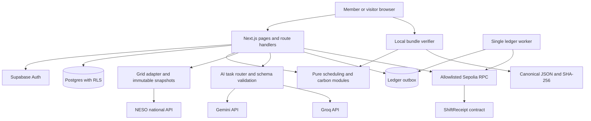

# CarbonShift — architecture and system design

Version 1.1 · 21 October 2026 · Working architecture and backend quality requirements; no services deployed.

## 1. Architectural choice

Use one Next.js application with a modular TypeScript core, Supabase Auth/Postgres, two small AI adapters, and a small Solidity contract. A separate single-instance Node ledger worker handles queued testnet writes. It can run on the builder's computer during the prototype; the UI must show when publication is queued rather than claiming always-on processing.

Alternatives considered:

- A browser-only planner is simpler but cannot safely hold provider keys or reliably manage accounts and receipt issuance.
- A microservice/agent platform adds deployment and coordination overhead without helping the bounded workflow.
- The selected modular application keeps scheduling and verification pure, while isolating network and persistence failures.

## 2. Component diagram



The database is the source of private application records. The contract is the source of anchored hashes and revision order. Neither independently verifies appliance operation. AI is a bounded transformation service and cannot call the database, RPC, or arbitrary tools.

## 3. Module contracts

| Module | Input → output | Dependencies and ownership |
|---|---|---|
| `domain/constraints` | Reviewed fields → validated UTC constraints or typed errors | No network; method rules |
| `domain/scheduling` | Constraints + immutable grid snapshot + profile → candidate comparison | Pure; no model or database |
| `domain/carbon` | Wh bins + aligned factors → integer mgCO₂ | Pure; never invent missing factors |
| `domain/proof` | Versioned manifest → canonical bytes/hash and checks | Shared browser/server, no secrets |
| `server/grid` | Requested UTC range → validated snapshot | NESO adapter, bounded cache |
| `server/ai` | Task context → validated suggestions/explanation keys | Gemini/Groq, limits, telemetry |
| `server/plans` | Authenticated command → immutable plan/report/result | Transactional DB operations |
| `server/publication` | Explicit consent + immutable revision → outbox operation | Publication validation, authorization |
| `worker/ledger` | Durable job → signed/broadcast/confirmed state | Dedicated testnet signer and RPC |
| `server/receipts` | Public receipt ID → approved manifest revisions | Sanitized projection only |

Dependencies flow inward toward `domain`; pure domain modules never import server modules.

### Functional backend requirement

Live screens consume authenticated persisted records, validated provider responses, and deterministic domain outputs. Never hardcode a successful save, impact total, user history, model response, or transaction confirmation. Failed dependencies return the specified error/unavailable states; mock adapters and authored fixtures are confined to isolated tests and the labeled demo. Method constants are named/versioned in the domain layer; credentials, deployment addresses, and model selections use validated environment configuration. No product phase passes on untested stubs.

## 4. Planning and acceptance sequence

```mermaid
sequenceDiagram
  participant User
  participant Web as App server
  participant AI as AI provider
  participant Grid as Grid adapter
  participant DB as Database
  User->>Web: Optional timing text
  Web->>AI: Bounded extraction request
  AI-->>Web: Candidate fields and source spans
  Web-->>User: Editable interpretation
  User->>Web: Confirm fields and compare
  Web->>Grid: Fetch covered forecast
  Grid-->>Web: Immutable normalized snapshot
  Web->>Web: Validate and compute deterministic candidates
  Web->>DB: Save private comparison with expiry
  Web-->>User: Baseline, recommendation, assumptions
  User->>Web: Accept comparison ID + version
  Web->>Web: Recheck time, ownership, expiry, snapshot identity
  Web->>DB: Atomic immutable accepted plan
  Web-->>User: Saved plan; optional publication
```

A stale comparison causes a new comparison and user review. The server must not accept one comparison while displaying another. Acceptance uses an idempotency key and a unique comparison-to-plan relationship.

## 5. Publication and reconciliation

1. Server builds the public manifest from allowlisted immutable fields.
2. User sees the publication preview and consents to its exact hash.
3. One DB transaction stores consent, manifest, and uniquely keyed outbox operation.
4. The worker claims a job using a database lease. Only one signer worker runs in the MVP.
5. It checks chain state before signing, validates commit deadline, obtains nonce, signs, and durably records the raw signed transaction before broadcast.
6. Broadcast may be retried with the same raw transaction. Do not allocate another nonce simply because a request timed out.
7. Persist transaction hash and receipt block hash; mark confirmed only after two confirmations.
8. Status requests compare with chain state. A lost/reorganized receipt returns to submitted/uncertain rather than staying falsely confirmed.

Raw signed transaction bytes belong in a worker-only table and must not appear in browser responses. A transaction is public once broadcast; the private signing key is never stored in the application DB.

The worker checks cancellation and commit deadline again immediately before signing, under the same plan/job lock used by cancellation. A live commitment arriving after the earlier baseline/selected start is rejected by the contract. Once a transaction is durably signed, cancellation cannot assume it can be recalled; reconcile it and expose the cancelled plan separately. Result revisions wait for confirmed plan commitment and preceding result revision.

## 6. Completion and corrections

A completion report is immutable. Recalculation fetches an actual-factor snapshot for both baseline and reported run; pending values yield a result with unavailable observed comparison. A later refresh creates another result revision referencing the same report. Editing the report creates a new report and result revision with a reason.

Private corrections do not automatically disclose new data publicly. A member separately previews/consents to each published result. Public revision numbers are consecutive and may skip private result revisions; both identifiers remain in the manifest. This prevents a hidden correction from being silently represented as publicly acknowledged.

## 7. Failure isolation

| Failure | Required behavior |
|---|---|
| AI timeout, schema failure, quota | Fall back within the bounded policy; then manual fields/template |
| Grid unavailable | Show last retrieval age; stale snapshots may be viewed but cannot create fresh live comparisons |
| Partial grid coverage | Refuse optimization over the incomplete requested window; show affected range |
| Auth unavailable | Keep public demo/read-only content available; refuse private writes |
| Database write failure | Do not acknowledge acceptance/publication; safe idempotent retry |
| Worker offline | Publication stays queued; private planning continues |
| RPC timeout | Preserve job/transaction reference; mark unknown state; check before retry |
| Contract revert | Show typed failure and preserve the private plan |
| Missing public bundle | On-chain hash still exists but content cannot be reconstructed; verification is unavailable |

## 8. Time, caching, and environment isolation

All stored instants are UTC. UI interprets scheduling fields in Europe/London regardless of the builder's location. Demo clock is injected only into demo/domain fixtures; live command handlers use server time.

Grid retrieval cache: five-minute reuse for identical covered requests. Forecast acceptance age cap: 30 minutes since retrieval, with explicit coverage checks; this is an application policy, not a supplier guarantee of forecast issuance time.

Local tests use an isolated database and local chain. Live deployment uses its own secrets and Sepolia contract. Demo fixtures never write into member live-plan tables. Testnet replay records carry `mode: demo` in both manifest and contract; they cannot become `live`.

## 9. Deployment boundary

Proposed web host: Vercel; data/auth: Supabase; ledger worker: explicit local Node process for the prototype. The public web app can run while the local worker is offline, but publication cannot complete then. Always-on external deployment requires moving that same worker to an approved persistent host and testing its restart behavior.

Deployment/manual steps are in [14](14-manual-setup-guide.md). Source versions and folder layout are in [05](05-tech-stack-and-folder-structure.md). Database authority is [06](06-data-model-and-state-machines.md); wire contracts are [07](07-api-and-integrations.md).
