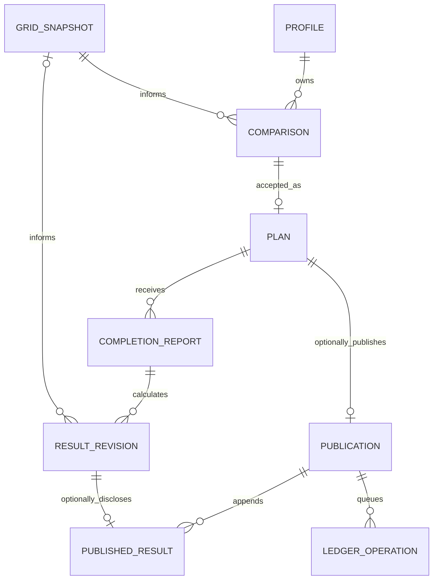

# CarbonShift — database, domain model, and state machines

Version 1.6 · 22 October 2026 · M04 persistence and M06 operational migrations implemented. Current local AI role evidence is recorded; M07 private completion is implemented; publication remains pending.

## 1. Representation rules

- IDs: random UUIDs for private records; cryptographically random 32-byte hex IDs for public receipts. Never derive public IDs from email, home location, or appliance identity.
- Timestamps: Postgres `timestamptz`; API/manifest UTC strings with seconds, such as `2026-10-21T09:00:00Z`.
- Energy: positive integer Wh. Carbon factors: nonnegative integer gCO₂/kWh. Calculation output: integer mgCO₂; render grams by dividing by 1,000.
- Durations: integer minutes; all calculation intervals are half-open `[start, end)`.
- Money is absent. Unknown numeric values use `null` with a status/reason, never zero.
- Authoritative records have a creation timestamp (`created_at`, or `accepted_at` for plans). Mutable operations additionally have `updated_at` and a version for optimistic concurrency.

## 2. Core types

`ConfirmedConstraintsV1`:

| Field | Type/rule |
|---|---|
| `geography` | Literal `GB_NATIONAL` |
| `timezone` | Literal `Europe/London` |
| `earliestStartUtc`, `deadlineUtc` | Valid resolved instants within allowed horizon |
| `durationMinutes` | One of 30, 60, 90, 120, 150, 180 |
| `energyWh` | Integer 50–5000; method assumption, not manufacturer certification |
| `energyBasis` | `user_estimate` or `illustrative_default` |
| `blockedIntervals` | Up to four nonoverlapping normalized UTC `{startUtc,endUtc}` intervals |
| `baselineStartUtc` | Explicit feasible start, including if generated from earliest feasible default |
| `baselineOrigin` | `user_selected` or `earliest_feasible_confirmed` |
| `confirmedAtUtc` | Server-recorded field review time |

`CandidateV1`: `startUtc`, `endUtc`, `energyWhBins[]`, `factorGPerKwh[]`, `estimatedMg`, `rank`.

`ComparisonV1`: constraints, forecast snapshot ID/hash, baseline candidate, selected candidate, up to three distinct alternatives, `differenceMg`, nullable `differencePercent`, `methodVersion`, `createdAtUtc`, `expiresAtUtc`. Percent is presentation-only; compare/rank using exact integer mg.

`GridSnapshotV1`: `geography`, `sourceUrl`, `retrievedAtUtc`, `providerIssuedAtUtc: null | timestamp`, `license`, ordered `intervals[{fromUtc,toUtc,forecastGPerKwh,actualGPerKwh}]`. Both factor properties may be null; their use is restricted by the method. Never invent provider issuance time from retrieval time.

### M02 shared contract clarification

The strict Zod schemas in `src/domain/schemas/` own these field names. Comparison snapshot references are `forecastSnapshotId` (UUID) and `forecastSnapshotHash` (lowercase `0x` plus 64 hex digits); candidates are `baseline`, `selected`, and `alternatives`. Ranks are one-based in the complete sorted candidate set; alternatives are the next three ranked candidates excluding the selected one (the baseline can appear). Snapshot hashes are supplied by trusted integration consumers; M02 does not implement or attest their digests.

UTC inputs require canonical whole-second `YYYY-MM-DDTHH:mm:ssZ` strings, with valid calendar dates and no leap seconds. Blocks must lie within earliest start/deadline; sorting is normalization, overlapping blocks are rejected, and touching blocks are allowed. `confirmedAtUtc` cannot be in the future relative to the injected comparison clock. External numeric factors and totals must be safe integers; intermediate arithmetic uses BigInt and rejects an unsafe final total.

The pure updated-result projection uses `reportId`, `snapshotHash`, `baselineActualMg`, `reportedActualMg`, `differenceMg`, nullable `differencePercent`, `status`, `reasonCodes`, and `deviationCodes`, alongside the evidence/method labels. No report yields `forecast_only`; a run with missing factors yields `actual_pending` with all updated amounts null. Report persistence, correction sequencing and cancellation authorization remain M07 responsibilities. Private report IDs are UUIDs; `did_not_run` after cancellation is a separate service-layer transition, not a bypass flag in the calculator.

M03's `GridSnapshotRecord` wraps the unchanged shared snapshot with server-generated `id`, `hash` and `attribution`. `hash` is SHA-256 over `CarbonShift:grid-snapshot:v1\n` followed by the normalized strict schema's fixed-order JSON projection. It includes truthful retrieval/source/license metadata; object input key order is normalized before hashing. It is a storage identity, distinct from M08's public JCS manifest/method hashes. Cache hits retain the entire original record; M04 persistence does not rewrite snapshots. Empty actual responses return null, not an invalid empty snapshot or zero-valued factors.

## 3. Relational records

| Table | Principal columns | Constraints/access |
|---|---|---|
| `profiles` | `user_id` PK/FK Auth, `created_at` | Owner read; no public profile directory |
| `grid_snapshots` | `id`, normalized JSON, digest, source, retrieval time | Insert-only by trusted grid service; no member writes |
| `comparisons` | `id`, `owner_id`, constraints/result JSON, snapshot FK, version, expiry | Owner read; server creates; immutable once issued |
| `plans` | `id`, `owner_id`, unique `comparison_id`, `mode=live`, accepted payload, `status`, accepted time | Server writes; immutable inputs; only status may cancel |
| `completion_reports` | `id`, `plan_id`, owner, sequence, `kind`, reported start, `profile_still_applicable`, reason, prior report FK | Insert-only; unique `(plan_id,sequence)`; newest report is current |
| `result_revisions` | `id`, `plan_id`, report FK, sequence, actual snapshot FK nullable, result JSON, reason | Insert-only; unique `(plan_id,sequence)`; recalculations create rows |
| `publications` | `id`, nullable unique `plan_id`, nullable `owner_id`, unique receipt ID, plan manifest JSON/hash, consent time/version, visibility | Owner read while linked; immutable manifest; public projection only |
| `published_results` | `id`, publication FK, nullable result revision FK, public sequence, manifest JSON/hash, consent | Unique `(publication_id,public_sequence)` and `(publication_id,result_revision_id)` |
| `ledger_operations` | `id`, publication/result FK, operation kind, expected hash, status, attempts, lease, transaction/block references | Private worker/service access; unique operation identity |
| `ledger_signed_transactions` | operation FK, nonce, raw signed bytes, transaction hash | Worker-only; persist before broadcast; never expose to web clients |
| `mutation_keys` | owner, route scope, idempotency key, request digest, response reference, expiry | Unique owner/scope/key; mismatch returns conflict |
| `ai_runs` | request ID, owner nullable, task, provider, model, prompt version, latency, token counts, outcome | Metadata only by default; no raw user text |
| `usage_buckets` | hashed subject, bucket type, window start, count | Atomic server-only limits; no arbitrary member writes |
| `ai_tasks` | owner, role, client task key, keyed input fingerprint, absolute deadline, state, timestamps | Unique owner/role/key; running/completed duplicates cannot redispatch; no raw text or extracted fields |
| `usage_reservations` | operation/attempt reference, shared bucket ID, metric, conservative amount, timestamps/expiry | Atomic rolling-window/request/token admission; unknown usage remains charged |
| `service_leases` | hashed scope, holder/fencing identity, expiry, cooldown/failure metadata | Cross-instance AI concurrency and one half-open provider probe; no member access |
| `ai_explanation_cache` | owner/comparison FK, task/prompt/schema/policy versions, validated code selection, creation/expiry | No raw model prose/timing text; owner-bound lookup; render current templates from immutable facts |

Use FK constraints, unique indexes, CHECK constraints, and database transactions rather than relying on a UI sequence. Restrict administrative SQL functions; secure any elevated function with fixed `search_path` and explicit authorization.

### M06 operational bookkeeping contract

Create the AI/reservation/lease/cache records in a new migration; never edit applied M04 migrations. `ai_tasks` states are `reserved`, `running`, `succeeded`, `failed`, `abandoned`. Allocate a durable `ai_runs` attempt number (1 or 2, unique per task) and reserve every affected bucket before dispatch. Lock bucket identities in stable order. Record dispatch intent before network I/O; interruption may leave a conservatively consumed reservation rather than justify a third call. Expired leases release concurrency, not daily charges or the task's dispatch history. Terminal task keys stay protected for 24 hours; an expired active task becomes abandoned, not silently restarted.

The keyed fingerprint binds role, exact timing text/reference context or comparison identity, prompt/schema versions and consent. The database binds that HMAC to the original policy digest; duplicate checks use the frozen digest even after a configuration edit. Source-span text is never trimmed or rewritten. Extraction outputs remain request/browser-memory data; do not persist them just to offer replay. A duplicate completed extraction yields its non-sensitive status, not a fabricated reconstruction. Task keys/input fingerprints are cleared after 24 hours by retention maintenance, while content-free run metadata follows seven days. Explanation cache entries contain only locally validated codes, expire within 24 hours and are invalidated by owner/comparison/version mismatch. They do not hold model prose or override mandatory limitations.

User/application daily windows use UTC. Gemini daily windows use explicit America/Los_Angeles calendar boundaries; rolling reservations use their actual expiry rather than a fixed “24 hours” approximation for a 23-/25-hour calendar day. Models/roles sharing a provider bucket reference the same stable ID. Per-user quota/lease subjects and login client identifiers use scoped HMACs; no raw IP/cookie/code/key is stored in these tables. Auth callback query codes never enter a fingerprint or log. Cleanup waits until every associated quota window/lease has expired; AI operational metadata retains the seven-day policy in document 11.

All new operational tables/functions are service-only with fixed search paths and RLS/no direct member writes. Validate identity and ownership before elevation. Account deletion removes task/cache links and eligible records without prematurely refunding shared provider/application reservations; retain only de-identified quota metadata until expiry. AI bookkeeping does not modify immutable accepted plan payloads. These targets do not claim an applied migration or working limiter.

For publications, use `ON DELETE SET NULL` on private plan/owner links; for published results, use it on the private result link. Published manifests contain their own sanitized snapshots and remain interpretable without those private rows. Account deletion can therefore remove private plans/reports/comparisons while retaining the disclosed proof and clearing owner links. Never cascade-delete an already-published proof by accident. Full retention policy is in [11](11-security-privacy-and-abuse.md).

### Implemented M04 storage contract

Migrations `20261021000100_private_planning.sql` and `20261021000200_acceptance_guards.sql` create only profiles, grid snapshots, comparisons, plans, mutation keys and usage buckets. The other rows above are later-phase targets. Existing applied migrations are immutable; corrections use a new migration.

Snapshots retain exact normalized `payload_text`, generated JSONB `snapshot`, retrieval time and digest. PostgreSQL recomputes the versioned storage hash over those bytes. Comparison JSON remains the strict domain `ComparisonV1`; API envelope IDs/versions are stored in relational columns. Constraints bind snapshot ID/hash and `(comparison_id,owner_id)` to their parents. The plan insert guard requires `accepted_payload` to equal the referenced comparison exactly. All accepted timestamps have whole-second precision so list cursors remain lossless. M04 blocks all plan updates; M07 must introduce narrowly controlled status transitions before cancellation exists.

`cs_create_comparison` atomically inserts the snapshot and comparison, checks freshness/expiry and rejects conflicting snapshot identities. `cs_accept_plan` serializes each owner/scope/key with an advisory lock and locks the comparison row; it checks owner, version, expiry, forecast age and the ten-minute start buffer, inserts one permanent plan per comparison and records its idempotency reference atomically. An identical retry returns that plan even after proposal expiry; an altered body with an unexpired reused key conflicts. Mutation keys last 24 hours; permanent comparison uniqueness still applies after key expiry. `cs_comparison_quota` atomically permits ten comparisons per hashed member/minute. Failed transactions roll back their associated records.

RLS grants members owner-only SELECT on profiles/comparisons/plans and SELECT on snapshots referenced by their own comparisons. No member or anonymous role can directly INSERT/UPDATE/DELETE any M04 table or execute privileged functions. Service writes use validated server identity; the secret key stays server-only. The trigger-created profile contains no copied email or provider profile. Account deletion cascades private M04 records; later publication migrations must add the documented retention/severing behavior first. Immutable snapshots may remain orphaned for the retention policy; they are inaccessible through member RLS without an owned comparison.

## 4. Relationships



Demo page fixtures are read-only local assets and are not represented as real users/plans. A testnet replay may be produced by an explicit operator script with `mode=demo`; it belongs in a separate fixture/export path and never appears in live member statistics.

## 5. Plan and completion transitions

Comparisons are immutable, short-lived proposals. Accepting creates `plans.status=accepted`. The server rejects expired comparisons or ones whose baseline/selected start is less than ten minutes away at acceptance.

An accepted plan may:

- Receive a `ran` report after the reported cycle has finished.
- Receive a `did_not_run` report after the selected cycle would have finished.
- Be cancelled before its selected start if no completion report exists. Cancellation atomically sets status and creates a `did_not_run` report with reason `cancelled_before_start`.

Cancelled plans are terminal in the MVP. A later actual run uses a new plan; do not revive an already-public cancelled commitment.

Correcting a completion creates a new report with `prior_report_id` and a nonempty reason. Current user-visible completion is derived from the newest report, never a mutable overwrite. Corrections cannot be future-dated.

For `ran`, `profile_still_applicable` is a required boolean confirming whether accepted duration/energy assumptions still apply. False preserves the report but yields `outside_supported_window` with reason `PROFILE_CHANGED`. For `did_not_run`, reported start and this confirmation are null. Do not infer confirmation from an omitted field.

Cancellation blocks a new publication preview. An unsigned queued commitment is marked failed/cancelled under the same plan lock. Already-signed or broadcast transactions cannot reliably be recalled: reconcile them and retain the cancelled status alongside any resulting original commitment. Publishing the non-run result requires separate consent.

## 6. Result statuses

| Status | Meaning and numeric policy |
|---|---|
| `forecast_only` | No completion report; original forecast comparison remains visible |
| `actual_pending` | Run reported but one or more baseline/run actual factors missing; observed totals/difference are null |
| `actual_estimate` | Complete actual-factor coverage; estimated cycle profile still assumed |
| `did_not_run` | No run comparison; all observed totals/difference are null |
| `outside_supported_window` | Reported time or changed profile cannot be evaluated under this method; explicit reason and no fabricated result |

Each result includes `executionBasis=self_reported`, `energyBasis`, method version, report ID, snapshot hash if present, baseline and reported run estimates, delta, and failure/missing-data reasons.

Refreshing pending data produces a new result revision and preserves the old state. Publish only explicitly approved revisions, with a separate consecutive public sequence. A private correction does not imply the current public receipt is up to date; owner UI says “Unpublished changes.”

## 7. Ledger operation transitions

```text
queued -> signing -> submitted -> confirmed
                 \-> failed
submitted -> uncertain -> submitted | confirmed | failed
confirmed -> uncertain  (chain reorganization detected)
```

A queued lease may expire and be reclaimed. Before reclaiming a signing job, inspect durable signed bytes and transaction hash. Signing and broadcasting are not safely repeated with fresh nonces.

Retries of the same command reuse the same operation and hash. Changing payload requires a new domain revision, not a reused idempotency key. `failed` does not erase the private plan.

Confirmation policy: two blocks after inclusion plus matching chain ID, contract address, event parameters, and canonical block hash. Two confirmations are a prototype policy, not finality assurance.

## 8. Transaction boundaries and authorization

- **Accept:** verify owner/expiry/version → insert plan once → store idempotency result.
- **Report/correct:** lock plan row → allocate report/result sequence → insert both → return canonical result.
- **Publish:** verify owner/consent/hash/time → insert immutable publication + outbox → return operation.
- **Publish result:** lock publication → allocate public sequence → store consent/manifest/outbox atomically.
- **Delete private data:** for individual deletion, check no publication dependency; for reauthenticated account deletion, stop unsigned queued work, reconcile already-signed operations, sever private/public links as above, then remove eligible private records. Preserve public commitments/disclosed copies as explained to the user.

Use user-scoped Supabase clients for owner reads. Privileged services performing writes must check validated Auth identity and ownership before use; never accept `owner_id` from the request body.

RLS tests must attempt cross-user SELECT, INSERT, UPDATE, DELETE and direct function calls. Public reads are dedicated allowlisted views/service projections filtered by explicit consent and visibility, never `SELECT *` on private tables.

### M07 private lifecycle wire/storage detail

`completion_reports` and `result_revisions` store immutable version-1 documents plus relational IDs, owner, plan and sequence. Reports have `id`, `planId`, `sequence`, `createdAtUtc`, `kind`, `reportedStartUtc`, `profileStillApplicable`, `correctsReportId`, `reason`, and `source` (`report` or `cancellation`). The bounded `note` field defaults to an empty string and retains the human cancellation explanation separately from `reason: cancelled_before_start`. Results have `id`, `planId`, `sequence`, `reportId`, `createdAtUtc`, `reason` (`submitted`, `correction`, `refresh`, `cancelled`), `actualSnapshotId` nullable, and the existing deterministic `result` object. Plan detail includes ascending `reports` and `revisions`, their latest entries, and derived completion. Snapshot lookup is owner-scoped through either comparisons or result revisions.

Lifecycle mutation responses are immutable acknowledgements `{planId, planVersion, reportId, resultId, changed, deleted}`. A 24-hour private mutation record preserves that exact response, including deletion acknowledgements; no report content is duplicated there. Parent-plan locks protect sequence allocation and expected current-report/result checks. Only plan status/version may change; accepted payload, owner, IDs and acceptance time remain immutable. Fresh actual retrieval metadata alone does not create a result revision: the semantic identity comprises result fields other than snapshot hash plus the actual factors overlapping the baseline/reported windows. Changed relevant factors create a revision even if rounded totals agree.

Private plan deletion also deletes its now-unreferenced comparison and releases orphan snapshots. Account deletion cascades private records, retains only expiring quota/admission metadata under existing retention, and removes orphan snapshots. Future public revisions must use nullable private links and extend deletion transactions before M09 activation.
