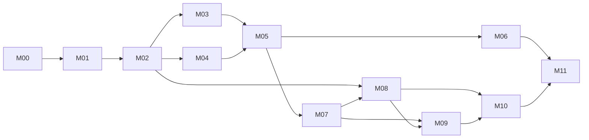

# CarbonShift — phased development roadmap for Codex

Version 2.3 · 21 October 2026 · 12 phases, 60 primary tasks. M00–M03 passed; M04.01 is next, with real database access required for its integration evidence. The current request stops at G03. Actual execution evidence lives in the status log.

## 1. How to execute this roadmap

This is the execution guide for a solo builder using Codex with the user's selected GPT-6.1 Sol configuration. It preserves milestone IDs `M00`–`M11` so existing specifications remain valid. Each milestone is now a phase with five individually verifiable tasks, numbered `Mxx.01`–`Mxx.05`.

Use one primary coding session at a time. One task should deliver a coherent, testable change. A phase may span several sessions; a session should not attempt an entire phase simply because the model has context available. If a task becomes too large, split it into lettered substeps such as `M09.03a` and `M09.03b`, preserving the parent task and its exit conditions.

This roadmap was created as a planning document. The user subsequently authorized M00 through M03. Use the status log for the current phase and stopping point; do not infer purchases or later-phase execution. Within authorized work, do not repeatedly ask for approval of routine choices already covered by the existing scope.

### Standard task loop

1. **Orient:** at every phase start, read root [AGENTS.md](../AGENTS.md), [current status](decisions-and-status.md), and all fourteen numbered documents, as the user requested. Within the phase, revisit the current task and specified sections. Inspect the working tree and actual files before making changes.
2. **Check readiness:** identify passed dependencies, available services, and any unsaved/user changes. Choose the earliest ready task; do not rewrite completed work.
3. **State the change:** name the task ID, expected result, intended files, and checks. Resolve interface conflicts in the owning specification before implementing them.
4. **Implement a small complete change:** keep business rules in their owning modules. Include meaningful tests with calculation, authorization, or state changes. Avoid unrelated refactoring.
5. **Verify:** run the targeted checks, inspect output, then exercise the relevant user/integration path. Use real service evidence only where the task explicitly requires it.
6. **Review:** inspect the diff for scope, leaked secrets, missing errors, duplicate logic, and mismatches with the specification. Fix issues before moving on.
7. **Checkpoint:** record actual files, commands, results, remaining failures, and the next task in the status log. Commit a coherent change when authorized by the repository workflow; otherwise leave a clear, reviewable diff.

Do not request a fresh user confirmation after every task. Continue through authorized ready tasks, subject to any user-requested stopping point. Ask only for a genuine missing decision, credential/setup dependency, material scope change, or action outside existing authorization.

## 2. Phase map and dependencies

| Phase | Outcome | Prerequisites | Main feature/test coverage |
|---|---|---|---|
| M00 — Readiness | Agreed scope, recorded service dependencies, first task ready | Documentation and build authorization when execution begins | Scope and setup |
| M01 — Foundation | Reproducible app shell, scripts, environment boundaries | M00 scope checkpoint | Foundation for all features |
| M02 — Domain engine | Correct constraints, scheduling, and carbon calculations | M01 | F03/F06; T03/T06 |
| M03 — Grid integration | Validated real grid snapshots and failure handling | M02 | F05; T05 |
| M04 — Accounts and data | Auth, RLS, immutable private plans, API operations | M01/M02; M03 adapter contract | F02/F07; T02/T07 |
| M05 — Manual planning | Complete usable manual planning journey | M03/M04 gates passed | F01/F03/F05/F06/F07 |
| M06 — Product AI | Evaluated Gemini/Groq assistance with manual fallback | M05; AI access for live evaluation | F04; T04 |
| M07 — Completion lifecycle | Reports, updated estimates, corrections, private history | M05; independent of M06 | F09/F12; T09/T12 |
| M08 — Proof and contract | Canonical bundles, local verifier, tested contract | M02; frozen M07 report/result contracts | F08/F10/F11 core rules |
| M09 — Publication | Consented publication, durable worker, actual testnet record | M07/M08; DB and testnet access | F08/F10; T08/T10 |
| M10 — Review experience | Public receipts, verifier, methodology, privacy, completed demo | M08; M09 contracts for local work, M09 gate for live proof | F10/F11/F12; T10/T11/T12 |
| M11 — Release verification | Integrated deployment, fresh-user checks, evidence-backed handoff | All preceding phase gates | All F01–F12 and T01–T12 |

The default order is numerical. Dependencies permit useful work while one external service is blocked: M07 does not depend on AI completion; M08 can be tested on a local chain; most M10 UI can use explicitly labeled fixtures before testnet publication. No phase is marked passed while its required live checks are pending.



The M07→M08 edge means the report/result interfaces are frozen; implementation against those fixtures may begin before every M07 screen is finished. Record such partial readiness explicitly rather than asserting the whole predecessor passed.

### External dependency gates

| Gate | Needed for | Work that can continue without it |
|---|---|---|
| G-DB: isolated Supabase/local test environment and Auth access | Real migrations, RLS/Auth integration and saved-plan validation | Pure domain logic, schema design, fixture UI |
| G-AI: keys, selected-model access, approved usage budget | Live Gemini/Groq smoke tests and held-out evaluation | Provider interfaces, validation, mocks, manual planner, completion flow |
| G-CHAIN: correct RPC, dedicated signer, faucet ETH | Sepolia deployment and actual publication | Hashing, local contract tests, local worker tests, fixture receipt UI |
| G-HOST: host access, deployment settings, usable email delivery | Fresh external-user deployment verification | Local production builds and isolated end-to-end tests |

Record each gate as `available`, `unavailable`, or `unverified`, with the affected tasks. Do not block the entire project on an unavailable optional account early in the build.

## 3. Detailed build phases

### M00 — Phase 00: establish scope and readiness

**Goal:** know exactly what to build and identify external dependencies before generating application code.

**Read:** [01](01-prd-and-blueprint.md), [08](08-scheduling-and-carbon-methodology.md), [09](09-ai-agents-models-and-workflow.md), [10](10-blockchain-and-evidence-specification.md), and setup checklist S01–S10 in [14](14-manual-setup-guide.md).

**Entry:** the user has authorized starting the build. Documentation-only requests do not enter implementation phases.

**Work area:** decision/status log and setup notes; no application scaffolding in this phase.

| Task | Deliverable | Verification / done condition |
|---|---|---|
| M00.01 | Record the accepted scope: GB national, washing-only, assumed energy, self-report, optional operator-issued receipts | Reconcile current user instructions with proposed D01–D12; list any unresolved material choice explicitly |
| M00.02 | Inspect existing repository, local runtime, and user changes; identify whether an app already exists | Record actual files/runtime evidence; preserve existing work; do not assume a blank repository |
| M00.03 | Create the G-DB/G-AI/G-CHAIN/G-HOST dependency inventory with who must supply what | Required secrets are named but never printed or pasted into documentation |
| M00.04 | Retrieve a representative public grid response and check current model catalogs/access where available | Record timestamp/source/schema observations; distinguish a catalog lookup from an authenticated model test |
| M00.05 | Select the first ready task and record the active scope/version plus external setup actions | A fresh session can identify M01.01 and any pending gates without redoing research |

**Exit gate G00:** scope is concrete and readiness is recorded. Missing keys may remain external blockers for later live tasks; they do not prevent local foundation/domain work. No partner, model access, or funding is invented.

**Human input:** only unresolved scope, account ownership, and budgets; use existing answers where available.

### M01 — Phase 01: build a reproducible foundation

**Goal:** create the smallest working application environment with clear server/browser boundaries.

**Read:** [04](04-architecture-and-system-design.md), [05](05-tech-stack-and-folder-structure.md), environment inventory in [14](14-manual-setup-guide.md), and secret boundaries in [11](11-security-privacy-and-abuse.md).

**Entry:** G00 passed; application implementation authorized.

**Work area:** root configuration, `src/app/`, environment/config modules, test configuration, `.env.example`, documentation version table. No planner or AI implementation yet.

| Task | Deliverable | Verification / done condition |
|---|---|---|
| M01.01 | Resolve supported Node/pnpm and compatible dependency versions; create the minimal Next.js/TypeScript app | Fresh frozen-lockfile install and production build work; exact versions recorded in document 05 |
| M01.02 | Add typed environment boundaries and separate web/worker configuration | Missing/invalid config produces useful errors; signer/model secrets cannot enter browser imports |
| M01.03 | Configure lint, typecheck, Vitest, Playwright, and contract tooling; register supported script names | Each implemented command invokes its real tool; no placeholder script that exits successfully without checking anything |
| M01.04 | Add minimal accessible app shell, design tokens, and a minimal health route | Page renders on mobile/desktop; health output contains no environment secrets |
| M01.05 | Write verified local setup instructions and establish baseline checks/CI for currently implemented scripts | Install/build/lint/typecheck pass; meaningful config tests pass; pending suites are explicitly unimplemented, not green |

**Exit gate G01:** a new checkout can reproduce the shell and checks. There is no fake product data or invented integration status. Later tasks may add scripts from document 05 as their functionality arrives.

**Human input:** none beyond existing local/repository access unless a real compatibility/setup blocker appears.

### M02 — Phase 02: implement the deterministic domain engine

**Goal:** make the mathematical and timing core correct before connecting UI or model output.

**Read:** core types in [06](06-data-model-and-state-machines.md), all method rules in [08](08-scheduling-and-carbon-methodology.md), calculation/timezone cases in [12](12-testing-and-ai-evaluation.md).

**Entry:** G01 passed.

**Work area:** `src/domain/`, `src/fixtures/`, targeted unit/property tests. No network, account, or model dependencies in these modules.

| Task | Deliverable | Verification / done condition |
|---|---|---|
| M02.01 | Shared schemas for constraints, candidates, grid snapshots, and comparisons; units/error vocabulary | Reject invalid fields/units/null misuse; API/domain adapters share one authoritative schema |
| M02.02 | UTC/local-time conversion, blocked-interval overlap, candidate generation, expiry/cutoff helpers | Midnight, exact deadline, repeated/nonexistent London times, and India-browser cases pass |
| M02.03 | Integer Wh bins, aligned and overlapping carbon arithmetic, percentages | Worked examples and energy-conservation properties pass; no divide-by-zero or intermediate rounding drift |
| M02.04 | Baseline validation, deterministic minimum selection/ties, and updated-result calculator | Reference enumeration agrees; negative updated differences, non-run, pending actual factors, and changed profiles are handled |
| M02.05 | Freeze versioned domain fixtures and method constants for integration consumers | T03/T06 domain assertions pass; same inputs/clock yield the same result; fixtures are labeled authored |

**Exit gate G02:** the core works without any external service. Method changes must update the owning specification, fixtures, and downstream consumers before further integration.

**Human input:** none for ordinary implementation choices within method v1.

### M03 — Phase 03: integrate and validate grid data

**Goal:** replace network stubs with an honest real-data adapter while preserving deterministic replay tests.

**Read:** grid integration in [07](07-api-and-integrations.md), freshness/coverage in [08](08-scheduling-and-carbon-methodology.md), relevant failure boundaries in [04](04-architecture-and-system-design.md).

**Entry:** G02 passed.

**Work area:** `src/server/grid/`, grid fixtures, snapshot schemas, adapter tests.

| Task | Deliverable | Verification / done condition |
|---|---|---|
| M03.01 | Typed national forecast and actual-range fetch adapter with allowlisted URL construction | URL/date validation and normalized output match the provider response; no user-controlled fetch destinations |
| M03.02 | Interval normalization and coverage/null/duplicate validation | Gaps, missing ends, overlap, wrong durations, nonfinite factors, and null forecast cases fail clearly |
| M03.03 | Timestamped immutable snapshot representation, provenance/attribution, cache and request coalescing | Cached requests retain truthful retrieval age; no fictitious provider issuance timestamp |
| M03.04 | Bounded timeout/retry and typed outage/stale-data errors | Timeout/outage tests preserve missingness; fixtures are never silently substituted into live results |
| M03.05 | One live read plus replayable sanitized fixture and end-to-end adapter-to-scheduler check | T05 assertions pass; record actual source/time/coverage; successful HTTP alone does not count as valid coverage |

**Exit gate G03:** real data can reach the calculator through validated snapshots, and failures do not generate recommendations. If the live source is down, local work can continue, but G03 stays pending.

**Human input:** normally none for the public feed; changed access conditions must be recorded.

### M04 — Phase 04: implement accounts, database, and private plan APIs

**Goal:** authenticated users can create and retrieve their own immutable plans through tested service boundaries.

**Read:** [06](06-data-model-and-state-machines.md), private endpoints in [07](07-api-and-integrations.md), authorization rules in [11](11-security-privacy-and-abuse.md).

**Entry:** G01/G02 passed; M03 adapter interface fixed. G-DB is required for migration/RLS integration evidence.

**Work area:** `supabase/migrations/`, `src/server/auth/`, `src/server/db/`, private plan services/routes, login/recovery routes, isolated integration tests.

| Task | Deliverable | Verification / done condition |
|---|---|---|
| M04.01 | Incremental migrations for profiles, snapshots, comparisons, plans, mutation keys, and required permissions | Apply cleanly to an isolated database; uniqueness/FKs/check constraints behave as specified; no destructive reset against deployed data |
| M04.02 | Supabase SSR login/signup/confirmation/recovery/sign-out and validated server identity | P02 plus recovery/callback route flows work in the test environment; redirects are allowlisted |
| M04.03 | RLS and service authorization with two test users | Cross-user SELECT/INSERT/UPDATE/DELETE and direct function attempts are denied; privileged paths enforce ownership |
| M04.04 | Comparison creation, immutable acceptance, owner list/detail APIs, idempotency and optimistic conflict handling | Real adapter connection plus injected fixtures; duplicate acceptance returns the same plan; changed body/key conflicts correctly |
| M04.05 | Transaction/concurrency/error tests and exact response-contract checks | T02/T07 targeted assertions pass; database failure cannot return a successful acceptance |

**Exit gate G04:** a test member can save a plan through the API and another member cannot access it. External email delivery remains separately checked before public onboarding in M11.

**Human input:** isolated Supabase project/local test-environment access and authentication settings. Prefer already-configured services; do not invent successful migrations.

### M05 — Phase 05: complete the manual planning experience

**Goal:** deliver the first useful end-to-end product before adding AI or blockchain interaction.

**Read:** page/flow definitions in [02](02-features-pages-and-flows.md), [03](03-ui-ux-and-design-system.md), and current private API contracts.

**Entry:** G03/G04 passed for the integrated gate. Fixture-based UI work may begin earlier without claiming a live flow.

**Work area:** P01/P03/P04/P05, planner/layout components, accessible chart/table, initial P12 fixture demo, browser tests. P02 remains owned by M04 and is integrated here.

| Task | Deliverable | Verification / done condition |
|---|---|---|
| M05.01 | Landing page, navigation, dashboard shell, explicit GB support and empty states | P01/P03 use actual API states; no fabricated impact totals, partners, or completed features |
| M05.02 | Manual task form and confirmed-constraint review | Units/timezone visible; invalid fields preserved and explained; baseline/default is explicitly reviewed |
| M05.03 | Comparison cards, chart plus accessible table, assumptions and source age | All numbers come from deterministic result objects; no-feasible/no-improvement/stale cases work |
| M05.04 | Acceptance and private plan-detail lifecycle | Save freezes exactly reviewed values; expired comparison requests re-review; plan does not start an appliance |
| M05.05 | Public fixture demo and manual browser journey at mobile/desktop widths | T01 and manual T03/T05/T06/T07 journeys pass; demo makes no paid API calls and stays labeled |

**Exit gate G05:** a fresh test user can enter a task, compare, and save without developer assistance or a functioning AI provider. Accessibility is checked now, not postponed entirely to the end.

**Human input:** brief review of the working primary journey when available; ordinary implementation does not need repeated permission.

### M06 — Phase 06: add and evaluate Gemini/Groq assistance

**Goal:** provide useful bounded AI assistance without moving arithmetic or decision authority into model output.

**Read:** [09](09-ai-agents-models-and-workflow.md), AI contracts in [07](07-api-and-integrations.md), quotas/privacy in [11](11-security-privacy-and-abuse.md), evaluation in [12](12-testing-and-ai-evaluation.md).

**Entry:** G05 passed. G-AI is required for live smoke tests/evaluation, not for adapter scaffolding and mock tests.

**Work area:** `src/server/ai/`, AI schemas/prompts, reviewed-constraint UI, usage metadata/atomic quota migration, evaluation fixtures/script.

| Task | Deliverable | Verification / done condition |
|---|---|---|
| M06.01 | Versioned interpreter/explanation schemas, prompt contracts, 20 development and 40 held-out examples | Human-check reference labels; split by example family; required ambiguity/source spans/limitation codes covered |
| M06.02 | Gemini provider adapter and configured-model smoke checks | Validate structured output locally; log metadata only; record actual model access, latency, and usage |
| M06.03 | Groq adapter with strict output where supported and configured-model smoke checks | Same application interface and local validation; do not assume SDK parameters match Gemini |
| M06.04 | Bounded router/fallback, atomic quotas, reviewed suggestions, and deterministic explanation templates | Injection/timeout/429/schema-failure paths pass; no autonomous tools or auto-acceptance; manual path stays usable |
| M06.05 | Held-out evaluation per model/prompt version and integrated browser flow | Record actual accuracy, corrections, latency, cost and failures; meet release policy or clearly default to manual/experimental mode |

**Exit gate G06:** both required providers are integrated and evaluated, failures are exposed, and no model output bypasses human constraint confirmation. If quality misses a target, follow the explicit manual-first policy and record the measured limitation. Missing live evaluation remains a blocker to claiming this phase complete.

**Human input:** keys/budget and gold-label review. While keys are pending, work on M07/M08 rather than adding more models or fake responses.

### M07 — Phase 07: finish reports, corrections, history, and private controls

**Goal:** preserve what was planned and distinguish it from what the user later reports.

**Read:** [06](06-data-model-and-state-machines.md), report/deletion APIs in [07](07-api-and-integrations.md), updated-estimate rules in [08](08-scheduling-and-carbon-methodology.md), retention in [11](11-security-privacy-and-abuse.md).

**Entry:** G05 passed; M06 is not a dependency.

**Work area:** report/result migrations, plan services, P06/P07, history/detail components, state/concurrency tests. Publication-aware deletion is extended after M09.

| Task | Deliverable | Verification / done condition |
|---|---|---|
| M07.01 | Append-only report/result schemas and transactional revision allocation | Concurrent submissions cannot overwrite or duplicate sequence numbers; corrections reference the current report |
| M07.02 | Run/non-run completion form/API with start and profile confirmation | Future runs rejected; changed assumptions preserve report but suppress unsupported calculations; original forecast retained |
| M07.03 | Actual-factor refresh and updated comparison | Pending data stays null; negative differences remain signed; unchanged refresh reuses existing result |
| M07.04 | Correction, cancellation, plan history and private-plan deletion | T09 state cases pass; immutable history remains; cancellation cannot be represented as avoided emissions |
| M07.05 | Settings/reauthenticated account-deletion baseline and complete private lifecycle tests | Owner controls work for unpublished data; schema supports later public links; publication-aware deletion acceptance explicitly deferred to M09/M11 |

**Exit gate G07:** complete private lifecycle passes, including `PROFILE_CHANGED`, non-run, pending/negative actual estimates, and concurrent corrections. Report/result interfaces are frozen for proof consumers.

**Human input:** optional realistic timing/profile example; authored fixtures suffice for software verification and must be labeled.

### M08 — Phase 08: build canonical proofs and the local smart contract

**Goal:** prove the integrity and computation mechanics locally before handling a funded signer.

**Read:** [10](10-blockchain-and-evidence-specification.md), method rules in [08](08-scheduling-and-carbon-methodology.md), contract/verifier tests in [12](12-testing-and-ai-evaluation.md).

**Entry:** G02 passed and M07 report/result contracts fixed. G07 integration is required before connecting private records, but pure proof work can use approved fixtures earlier.

**Work area:** `src/domain/proof.ts`, manifest schemas, method descriptor, golden fixtures, `contracts/`, local-chain and browser/server parity tests.

| Task | Deliverable | Verification / done condition |
|---|---|---|
| M08.01 | Canonical plan/result/method schemas and sanitized export builder | Reject unknown/unsafe fields; public projection omits identities/raw text; modes/profile confirmation preserved |
| M08.02 | JCS hashing, domain prefixes, persisted nonce rules, golden digest vectors | Browser/server results agree; key-order variation is stable; input mutation changes digest |
| M08.03 | Pure verifier for schema, known method, arithmetic, feasibility, optimum, and revision chain | Tampering/unsupported-method tests work independently of stored totals or trusted server verdicts |
| M08.04 | Small `ShiftReceipt` contract and versioned ABI/build artifacts | Authorized commit/append works; duplicate IDs, unauthorized writes, late cutoffs, bad revisions fail locally |
| M08.05 | Local-chain full proof fixture and independent recheck of ownership/timing/mode rules | Contract suite plus golden vectors pass; original issuer/current owner and demo/live semantics are correct |

**Exit gate G08:** locally reproducible proof and contract tests pass. No claim of actual testnet deployment yet. Do not add tokens, upgradeable proxies, oracle services, or additional signing roles.

**Human input:** none for local testing under the approved interface.

### M09 — Phase 09: implement consented publication and the ledger worker

**Goal:** safely turn a reviewed manifest into a real testnet record, surviving retries and interruptions.

**Read:** publication flow in [04](04-architecture-and-system-design.md), states in [06](06-data-model-and-state-machines.md), endpoints in [07](07-api-and-integrations.md), [10](10-blockchain-and-evidence-specification.md), [11](11-security-privacy-and-abuse.md).

**Entry:** G07/G08 passed. G-DB required throughout; G-CHAIN required only for deployment/live publication, not isolated worker tests.

**Work area:** publication/public-result/outbox migrations, publication services/routes, ledger worker/reconciliation, consent UI on P05, contract deployment scripts.

| Task | Deliverable | Verification / done condition |
|---|---|---|
| M09.01 | Immutable publication previews, exact-hash consent, private/public sequence mapping | Changed/expired preview requires fresh consent; private corrections cannot auto-publish |
| M09.02 | Transactional outbox, operation identity, job leases, signer configuration boundary | Concurrent duplicate requests create one operation; web runtime has no signing key |
| M09.03 | Persist-before-broadcast signing, nonce/retry/reconciliation, confirmed/uncertain state handling | Crash before/after sign/broadcast/mining tests pass; reorg/unknown receipt cannot remain falsely confirmed |
| M09.04 | Publication UI/status plus cancellation and account-deletion race handling | Unsigned cancellation stops work; signed transaction is reconciled; public records survive eligible private deletion |
| M09.05 | Sepolia deployment and actual commit/result publication with recorded evidence | Correct chain/bytecode/owner; transaction matches hash/event; two confirmations observed; worker-off planning still works |

**Exit gate G09:** one genuine testnet flow is confirmed and exportable; a repeated request cannot produce another enrolled record. Worker restart and cancellation/deletion interactions pass. If M09.03 is too broad for one session, split its signing, retry, and reconciliation tests into named substeps.

**Human input:** dedicated wallet/faucet/RPC access and existing deployment authorization. No personal wallet or real-fund purchase is required. If funding is unavailable, keep G09 pending and finish eligible M10 fixture work.

### M10 — Phase 10: finish public receipts, verification, and supporting pages

**Goal:** make the result understandable and independently inspectable by someone who did not build the app.

**Read:** P08–P12 in [02](02-features-pages-and-flows.md), [03](03-ui-ux-and-design-system.md), method explanations in [08](08-scheduling-and-carbon-methodology.md), proof checks in [10](10-blockchain-and-evidence-specification.md), privacy in [11](11-security-privacy-and-abuse.md).

**Entry:** G08 for local verifier work; M09 public response contracts fixed; G09 before claiming live integration complete.

**Work area:** public receipt projections/routes, P08/P09/P10/P11, extensions to existing P12, local import/download UI, browser/accessibility tests.

| Task | Deliverable | Verification / done condition |
|---|---|---|
| M10.01 | Public receipt summary/revisions and allowlisted bundle/chain endpoints | No private fields; only consented revisions; missing content differs from invalid proof |
| M10.02 | Receipt page with original/current comparison, history and separate evidence checks | No blanket “verified savings” badge; pending/failed/demo/self-report labels remain visible |
| M10.03 | Local JSON import/export and independent verifier page | Size/schema restrictions; no arbitrary fetch/eval; valid bundle reproduces, modified bundle fails, RPC outage is unavailable |
| M10.04 | Methodology/privacy pages and consistent consent/retention wording | Content matches implemented behavior; actual operator contact required before public invitation |
| M10.05 | Extend the existing demo with tampered/missing/blocked cases; run a fresh-reviewer journey | T10/T11/T12 targeted checks, mobile/keyboard/accessible-table tests, and real testnet receipt inspection pass |

**Exit gate G10:** another person can understand the evidence basis, download a bundle, and distinguish a real match from tampering or unavailable data. P12 from M05 is extended, not independently rebuilt.

**Human input:** operator contact and optional reviewer feedback. Do not claim user validation merely because the builder completed the flow.

### M11 — Phase 11: verify, deploy, and hand off the integrated product

**Goal:** close integration gaps and report only what actually works in the deployed configuration.

**Read:** complete [12](12-testing-and-ai-evaluation.md), deployment/setup steps in [14](14-manual-setup-guide.md), current limitations/status, and changed specifications.

**Entry:** G00–G10 passed or an explicit user-agreed scope change recorded. G-HOST required for the external deployment checks.

**Work area:** targeted fixes across the app, deployment configuration, retention cleanup script, verified README, evidence/status. No new features.

| Task | Deliverable | Verification / done condition |
|---|---|---|
| M11.01 | Complete feature/page/API coverage audit and integrated local acceptance run | All F01–F12/T01–T12 covered; no route/feature remains a stub; full local production build works |
| M11.02 | Security/privacy/failure regression and retention cleanup | Cross-user tests, secret scan, quota tests, provider outage, cancellation/deletion races, dry-run cleanup and actual test-environment cleanup pass |
| M11.03 | Responsive/accessibility/performance review with measured results | 360/768/1440 px, keyboard, zoom, reduced motion, screen-reader smoke check; report latency hardware/sample size honestly |
| M11.04 | Web deployment, Auth redirect/email verification, worker startup, fresh external-user journey | Record actual URL/build/contract; signup/recovery and real plan/publication work; laptop-worker availability limit is visible |
| M11.05 | Final reproducibility check and evidence-backed handoff | New checkout follows verified setup; current README/specs/status agree; remaining limitations and exact outstanding actions are explicit |

**Exit gate G11:** required acceptance evidence exists for the actual build/environment. If a required live check is blocked, deliver the tested subset and name the incomplete gate; do not call the whole product finished.

**Human input:** hosting/email settings, any paid-plan decision, and fresh-user/reviewer checks where available. Standalone operations/submission documents remain excluded as requested.

## 4. Contracts and file ownership across phases

| Boundary | Established in | Consumers / rule |
|---|---|---|
| Core constraints, units, timestamps, result types | M02.01–M02.05 | M03–M10 import these; no parallel alternative definitions |
| Grid adapter response and errors | M03.01–M03.04 | M04/M05/M07 consume one validated snapshot contract |
| Auth identity, owner APIs, idempotency | M04.02–M04.05 | All later private/publication mutations reuse these checks |
| Report/result revisions and profile confirmation | M07.01–M07.03 | M08/M09/M10 preserve meaning and immutable history |
| Manifest hashes/method descriptor/ABI | M08.01–M08.05 | M09/M10 use generated artifacts; never manually copy a different ABI |
| Publication consent and chain operation status | M09.01–M09.04 | M10 displays real states, never infers confirmation from submission |

When a boundary changes, identify all consumers, update its authoritative document and fixtures, and rerun affected tests before resuming downstream work. Do not solve type errors by weakening validation or adding incompatible duplicate schemas.

Default to one writer per shared file. Do not spawn extra coding agents merely because the user is using Codex. If the user explicitly authorizes delegation later, assign disjoint modules with named interfaces and one integration owner; serialize migrations, lockfile changes, shared schemas, and final integration.

## 5. Page, API, and requirement coverage

| Scope | Primary delivery | Final integration check |
|---|---|---|
| P01 landing, P03 dashboard, P04 planner, P05 plan detail | M05; detail extended in M07/M09 | M11.01 |
| P02 login plus recovery/callback | M04.02 | M11.04 external email flow |
| P06 completion and P07 settings | M07 | M09.04/M11.02 publication-aware deletion |
| P08 receipt and P09 verifier | M10.01–M10.03 | M11.04 actual published record |
| P10 methodology and P11 privacy | M10.04 | M11.05 claims match behavior |
| P12 public demo | M05.05, extended M10.05 | M11.01; no paid requests |
| Comparison/plan list/detail/acceptance APIs | M04.04 | M05.05/M11.01 |
| AI endpoints, quotas, telemetry | M06 | M11.02 |
| Reports/refresh/cancel/delete APIs | M07 | M09.04/M11.02 |
| Publication previews/consent/operations | M09 | M10/M11.04 |
| Public receipt/bundle/chain APIs | M10 | M11.02/M11.04 |
| Health/configuration | M01.02/M01.04 | M11.04 |

T01–T12 in document 12 remain the source of acceptance requirements. A phase may pass its scoped tests without claiming every assertion under a broad feature has passed; final feature completeness is audited in M11.

## 6. Test commands and evidence

The following include **target script names** from document 05. M01 implements the foundation subset; later integration/evaluation/worker scripts remain targets. Inspect `package.json` before running commands; use actual supported test selectors rather than inventing runner flags.

| Change | Minimum relevant verification once scripts exist |
|---|---|
| Domain math/time/schema | `pnpm typecheck`, targeted `pnpm test`; independent expected-value/property fixtures |
| Database/Auth/API | Targeted `pnpm test:integration` against an isolated environment; two-user authorization checks |
| UI and browser behavior | Relevant component tests and `pnpm test:e2e`; keyboard/mobile/manual checks |
| AI adapters | Mocked contract/failure tests; explicit `pnpm eval:ai` for paid holdout evaluation |
| Contract/hash/worker | `pnpm contracts:test`, digest parity tests, worker failure tests; explicit testnet evidence separately |
| Phase integration / release | `pnpm lint`, `pnpm typecheck`, applicable suites, `pnpm build`, fresh environment smoke checks |

Run targeted checks after each change. Run the applicable broader checks at phase integration. Repeat a full suite when new changes/failures justify it, rather than repeatedly consuming time after an unchanged pass.

Offline mocks are useful test inputs, not proof of a real integration. No assertion about successful provider access, RLS, deployment, or a transaction may rely only on a screenshot or generated text.

## 7. Status, checkpoints, and recovery

Track actual progress in `docs/decisions-and-status.md`; do not create another competing task tracker. Use `not_started`, `ready`, `in_progress`, `blocked`, or `passed` for task status. Here, `blocked` is a planning label for a task dependency, not a tool-managed goal status. Readiness/status must be supported by dependency evidence.

Use this compact handoff format when a task ends or the session needs to stop:

```text
Task: Mxx.yy (and substep if any)
Status:
Scope/spec version used:
Dependencies and external gates:
Changed files:
Checks run and observed results:
Manual/live checks and environment:
Unresolved failures or decisions:
Next ready task:
Exact command/action to resume:
Relevant commit or reviewable diff:
```

On resume, inspect the current files and status. Verify whether any reported check is invalidated by later edits. Re-run affected checks only, then continue. Preserve uncommitted user work; do not reset, regenerate, or overwrite a working module simply because a prior chat is unavailable.

If a task fails, keep its failing fixture, diagnose the cause, repair within scope, and rerun that check before progressing. If an external gate blocks it, mark the specific task pending and choose a ready independent task from the dependency map. Do not replace missing data with plausible values or bypass security to force a demonstration.

## 8. Reusable Codex prompts

### Start one phase

```text
Execute phase M02 from docs/13-development-roadmap-and-codex-tasks.md.
Read AGENTS.md, the current status, and M02's required specifications.
Check that prerequisites are actually satisfied.
Implement its tasks one at a time, preserving existing work.
Run each task's checks and inspect the results.
Update task status with evidence and the next ready task.
Stay within the phase scope; stop at its exit gate or a genuine blocker.
```

Replace `M02` with the requested phase; this prompt does not imply that a whole phase fits one context window.

### Execute one task

```text
Implement M07.03 only against the current roadmap and owning specs.
Inspect existing code and prerequisite evidence before editing.
Keep calculations in the domain module and network access in the adapter.
Test missing actual data, negative differences, and unchanged refresh.
Report the changed files, checks actually run, and any remaining gap.
Update decisions-and-status.md with a precise resume point.
```

### Continue authorized work

```text
Continue CarbonShift from the latest verified task in the status log.
Choose the earliest ready task in the roadmap and work sequentially.
Do not redo completed work or silently change interfaces/scope.
If a service is unavailable, continue eligible independent local work.
Keep progress updates concise and save a handoff before stopping.
```

## 9. Effort, scope, and stop conditions

Retain the provisional **60–80 focused engineering-hour** estimate for the full specified MVP, including integration, evaluation, corrections, and deployment verification. It is not a sum of model generation time and does not promise a completion date. Re-estimate after M02/M05 using actual progress. Check the current hackathon deadline separately before allocating remaining work.

M02 estimate checkpoint: pure-domain correctness now has measured test/performance evidence, but no integrated grid/Auth/AI/ledger journey exists yet. There is no measured integration effort supporting a tighter remaining-hours forecast. Keep the full-build estimate provisional with low confidence and reassess at M05; do not convert fast agent generation or a local millisecond benchmark into a delivery promise.

A task should normally fit a small reviewable change; a large worker, migration, or evaluation task may need several substeps. Do not squeeze unfinished work into a “passed” phase to meet an estimate.

Simplify presentation polish, motion, and optional explanation detail before reducing correctness. Do not remove explicit scope requirements such as alternative candidates, both provider integrations, corrections, or public evidence without recording an agreed scope change. Never cut authorization, data provenance, truthful labels, manual fallback, or secret isolation to save time.

After each phase, the app should either have a demonstrable new capability or a tested prerequisite used by the next phase. If a phase has produced only empty screens, broad scaffolding, or unverified generated code, its gate has not passed.

This roadmap ends at a verified, handed-off application. It does not recreate the removed standalone operations or hackathon-submission documents.
