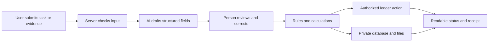

# CarbonShift, eWasteChain, and ClosetCarbon: practical build guide

Prepared **19 October 2026** for a **solo builder using AI coding agents**. This explains three alternative products so the user can choose one. It is a comparative build brief, not an approved implementation specification. No app, account, contract, or external project was created for this guide.

Read alongside the [ranked assessment](project-ideas-claude-analysis.md). The names and broad directions come from [Project Ideas (Claude)](project-ideas-claude.md); the scopes below incorporate the factual corrections from the assessment. Existing products cover parts of all three, so each proposed difference needs validation.

**Build one mobile-friendly web app, not three apps.** None requires a native Android/iOS app, a custom AI model, a new cryptocurrency, or custom hardware for a software proof of concept. Actual automation, physical verification, and deployment have additional dependencies described below.

All numerical walkthroughs are **illustrative test scenarios**. They are not measured project impact, appliance benchmarks, or actual recycling records.

## 1. A common technical foundation

| Part | Suggested choice | What it does |
|---|---|---|
| Website and server | Next.js, TypeScript; a simple responsive interface | Displays screens, handles user requests, and calls external services from the server |
| Accounts and records | Supabase Auth and PostgreSQL | Stores users, jobs, extracted fields, approvals, and permissions |
| Photos/documents | A private Supabase Storage bucket | Keeps original evidence out of the public ledger; grants authorized access |
| In-app AI | One API supporting text/images and structured responses | Extracts fields or constraints; returns unknown when unsupported |
| Deterministic business logic | TypeScript functions | Enforces units, quantities, time windows, calculations, and permitted state changes |
| Blockchain | One small Solidity contract on Sepolia | Records approved commitments/events and enforces the selected shared-state rule |
| Contract integration | One EVM client library, such as viem | Reads contract state and submits authorized transactions |
| Hosting | One web-hosting account that supports the chosen Next.js deployment | Gives judges a working public URL |
| Project delivery | GitHub repository, README, demo fixtures, evaluation notes, recorded video | Makes the submission reproducible and inspectable |

This is a suggested stack, not a requirement or a guarantee about any free plan. Next.js documents the App Router and server/client capabilities. Supabase documents database access policies and private file access. Ethereum currently recommends Sepolia for application development. Confirm service limits and integration details when implementing. [Next.js](https://nextjs.org/docs/app), [database permissions](https://supabase.com/docs/guides/database/postgres/row-level-security), [private storage](https://supabase.com/docs/guides/storage/buckets/fundamentals), [Ethereum networks](https://ethereum.org/developers/docs/networks/)

**Coding agents and product AI are different.** Coding agents help write and inspect the application. The deployed application's extraction feature needs its own model integration, credentials, usage allowance, error handling, and evaluation. Using a coding agent does not automatically supply that feature.

### How information moves

AI drafts information; people confirm consequential fields; deterministic rules control state changes. Raw uploads and model text never get authority to sign a transaction. Treat uploaded instructions as untrusted document content.

### Database versus blockchain

The database stores detailed, editable working information with access controls. The chain stores the approved event/commitment and enough public structure to verify the intended rule: random job ID, actor, version, evidence commitment, status, and selected non-sensitive values. Sensitive originals stay private. Use standardized serialization, schema versions, and salted/nonced commitments where appropriate; a bare hash of predictable personal information is not sufficient privacy.

Keep the app's transaction state explicit: pending, confirmed, or failed. A submitted transaction is not a confirmed record. An evidence hash cannot restore a deleted file, so preserve permission-compatible evidence and exportable records separately.

Ordinary people can open a public receipt link without a wallet. For the hackathon, use clearly identified role accounts and separate test wallets for the parties who sign contract actions. If all keys are controlled by the builder, say they are demo roles. A production wallet-free signing arrangement is a later design choice with real custody and trust implications.

## 2. CarbonShift: help a person choose a feasible lower-carbon time

### What the product does

A user says what household task must finish, when it can run, and what restrictions matter. The app compares feasible start times against grid-intensity information and recommends a window. Afterwards, it distinguishes a recommendation from a self-reported or metered execution result.

**First version:** one appliance category, one supported geography, one cycle at a time. Use Great Britain because the selected public API covers GB. An Indian user may explore the labeled GB demonstration, but the app must not apply GB factors to their home.

### End-to-end workflow

1. **Set region and task.** Choose a supported region/postcode, appliance profile, duration, earliest start, deadline, and expected energy. Values can be manually confirmed; the profile is an assumption unless measured.
2. **Describe constraints.** For example: “Finish the wash by 7 pm. Do not run it from 3–5 pm.” AI drafts structured time constraints. A review screen shows exactly what it understood.
3. **Fetch the signal.** The server requests suitable GB carbon-intensity forecast intervals, records their source/retrieval time, and checks coverage. Store UTC internally and display the user's local time. Do not assume every local day has exactly 48 half hours.
4. **Compare valid windows.** Ordinary code enumerates feasible start times, rejects deadline/noise conflicts, and calculates the modeled emissions for each remaining option. No feasible window produces a useful explanation rather than an invented recommendation.
5. **Explain and accept.** The user sees the recommendation, baseline, estimated difference, and assumptions. Cost is shown only if an applicable tariff is provided; low-carbon does not always mean cheapest.
6. **Commit the agreed plan.** Record the job, method, baseline, profile, forecast version, and approved schedule before the proposed future run. A later override creates a new event instead of silently rewriting the plan.
7. **Report execution.** Accept an appropriate interval CSV if available. Otherwise allow self-report and retain that label. A recommendation alone cannot become a completed or verified shift.
8. **Publish a bounded receipt.** Show the agreed plan, actual/declared execution, calculation basis, and whether evidence is complete. Missing interval readings can produce insufficient evidence. A verifier can check the enrolled record and its corrections.

The [GB API](https://api.carbonintensity.org.uk/) supplies historical and forecast endpoints; it does not supply household meter readings. NESO describes the national `actual` value as an estimate from metered generation. Forecasts and later grid estimates must be distinguished in the result. [Method explanation](https://carbonintensity.org.uk/)

### An understandable example

Assume an illustrative one-hour cycle uses 1 kWh, spread equally over its two half hours:

| Candidate window | Intensity in the two half hours | Modeled emissions |
|---|---|---:|
| Default 6–7 pm | 300 and 340 gCO₂/kWh | `0.5 × 300 + 0.5 × 340 = 320 g` |
| Feasible alternative 2–3 pm | 100 and 140 gCO₂/kWh | `0.5 × 100 + 0.5 × 140 = 120 g` |

The modeled difference is **200 g** under that stated profile and comparison. A real cycle has a changing load shape; use interval kWh where available. This accounting difference is not automatically a causal reduction in grid emissions, a tradable credit, or proof of appliance execution.

### AI and blockchain roles

**AI:** the initial bounded job is interpreting a user's natural-language constraints into reviewable fields. Evaluate about 30–50 disclosed prompts containing ambiguous dates, contradictory restrictions, missing values, and different wording. Compare with a manual form and report correct constraint extraction, unsupported assumptions, and correction effort. The scheduling algorithm remains deterministic. Add a new forecasting model only if it can be meaningfully evaluated against the forecast already supplied.

**Blockchain:** a proposed `ShiftReceipt` contract preserves a plan commitment and its subsequent evidence/status. Authorized roles can record review, override, or dispute. It rejects a repeated enrolled cycle claim and unauthorized changes. The identifier must include the relevant actor/job/program context; different households can legitimately use the same time interval.

This has a stronger rationale if an independent operator/incentive program needs common verification. A private household scheduler alone could use a database. The app must not imply an actual utility partnership, funded reward, carbon-market entitlement, or guaranteed measurement.

### What to build

| Screen/module | Minimum function |
|---|---|
| Task setup | Region, appliance profile, time constraints, expected energy |
| AI review | Confirm or correct extracted restrictions |
| Window comparison | Intensity curve, feasible options, baseline, assumptions |
| Accepted plan | Method/version and schedule commitment |
| Completion review | Import or self-report with an honest evidence label |
| Receipt/verifier | Current status, history, calculation, contract reference |

Main records: user/region, task, appliance profile, constraints, source intervals, proposed schedule, accepted commitment, execution evidence, calculation, and challenge/correction.

### What you need

- Public grid-data access and a cached, source-labeled demonstration replay.
- One explicit appliance load profile, from a permitted source or a disclosed authored fixture. Better evidence is a permissioned interval-meter example.
- A model API for constraint extraction and a small labeled evaluation set.
- The common website/database/testnet setup.
- A clear user benefit beyond existing carbon-aware schedulers. The [earlier assessment](project-ideas-claude-analysis.md) documents direct prior art.

**First demonstration:** input a task → correct an AI interpretation → compare windows → commit → report an override or missing data → show the honest result → reject a repeated enrolled receipt. If replaying historical data, label the replay and current demonstration commitment; do not claim the contract was committed before the historical event.

**Scope cuts:** no appliance integrations, automatic washing-machine control, EV support, learned household habits, live payments, custom carbon credits, or country-wide support. Manual recommendations work without extra hardware; real automatic execution requires compatible integrations, and measured execution requires an adequate data source.

**Planning estimate:** approximately **40–50 focused hours for this bounded scope**, including integration, evaluation, deployment, documentation, video, and contingency. Estimate only; coding experience and access can change it substantially.

## 3. eWasteChain: make a device's handovers and unresolved evidence visible

### What the product does

A person hands over an old device and receives a traceable job link. Each organization records what it actually received or claims to have done. The owner can see a disputed or unfinished downstream trail rather than treating pickup as proof of responsible recycling.

**First version:** laptops only, one collector, one processor, one downstream receiver, and a small batch. Prefer a repair/refurbishment route where appropriate; recycling is not automatically the best outcome for a usable product.

### End-to-end workflow

1. **Register a device.** Owner provides category, optional model/photo, and a redacted identifier. The app creates a random device/job ID and shareable receipt link. A supplied serial is evidence, not infallible physical identity.
2. **Confirm collection.** Collector records the received item, time, condition, and receipt. Owner/collector acknowledgments remain distinguishable; one party's statement is not silently promoted into both parties' agreement.
3. **Record the route.** Processor records inspection and proposed refurbishment or recycling. Owner sees why the status changed. A claim about successful data erasure is separate and needs its own competent evidence.
4. **Create/receive a batch.** If devices are combined, preserve the mapping between device jobs and the material batch. A sender declares a quantity; the receiver accepts it or records a discrepancy.
5. **Upload processing records.** AI extracts batch ID, date, material, quantities, units, organization, and document reference. Human reviewers confirm critical fields and unknowns.
6. **Run consistency checks.** Deterministic rules flag duplicated enrolled records, mismatched batch IDs, impossible declared totals, or a missing receiver acknowledgment. Additional inputs, processing changes, units, and tolerances must be represented before interpreting a mass difference.
7. **Obtain downstream acknowledgment.** Receiver confirms what was received, not what it cannot observe. A processing certificate and buyer receipt are different evidence types.
8. **Show the consumer's status.** Examples: collected; processor received; refurbishment reported; downstream receipt pending; discrepancy under review; or documented route complete under the stated policy. Do not display an unqualified “responsibly recycled” badge merely because all forms exist.

### A concrete discrepancy example

An illustrative handover declares a **10 kg** batch. Its receiver records **8.4 kg** at the same handover stage. The product shows an unresolved **1.6 kg difference**, with the weighing basis and both records. AI may identify a wrong batch reference or unit inconsistency; it does not decide that a person committed fraud.

If later processing outputs total 12 kg against only 10 kg of eligible inputs, the app asks for an explanation or additional input records. A simple conservation rule is valid only within an explicit material boundary. Do not infer per-device gold/copper recovery after mixed processing unless appropriate measurement supports it; proportional allocation is an accounting estimate.

### AI and blockchain roles

**AI:** extract and reconcile processing/handover documents, referring each value back to its source. This is a plausible bounded task. Build about 20–30 representative or clearly authored document fixtures covering missing dates, g/kg confusion, changed references, illegible fields, and partial receipt. Compare with simple forms/template extraction. Report field accuracy, abstention, and correction effort.

Exact duplicate-file checks and quantity checks are ordinary software rules, not evidence of advanced AI. A model can flag suspicious evidence for review. It cannot certify safe processing, identify every synthetic/stock photo, or prove that the photographed device is the consumer's device.

**Blockchain:** a proposed `DeviceTrail` contract records authorized handover states, evidence commitments, disputes, and corrections. It rejects replayed enrolled event IDs and unauthorized completion. Sender and receiver can disagree without one deleting the other's record. Independent signers make the common record more useful, but the chain still relies on operator identity, weighing, and truthful evidence. Duplicate identity rules work within the enrolled system, not across every recycler worldwide.

### What to build

| Screen/module | Minimum function |
|---|---|
| Device registration | Simple owner form and receipt link |
| Collector workspace | Accept item and record handover |
| Processor workspace | Route, batch association, evidence upload |
| AI review | Extract/correct document fields and see discrepancies |
| Receiver workspace | Accept/reject a handover and quantity |
| Public receipt | Stage, evidence provenance, unresolved issues, corrected history |

Main records: actor/role, device job, route, batch, batch membership, handover, quantity/basis, evidence, extraction review, processing declaration, acknowledgment, and dispute/correction.

### What you need

- Photos of one or two permission-compatible example devices; they need not be destroyed for the software demonstration.
- Representative handover/processing records, preferably with permission from an operator. Otherwise create explicitly authored forms and reduce real-world claims.
- Four demo roles: owner, collector, processor, and receiver. State clearly when one builder controls them.
- A model API that reads documents/images, private upload storage, the website, and a small contract.
- An evidence policy: who may attest each stage, what counts as missing evidence, and how disputes are resolved.

Global e-waste reports supply context, not task-specific training labels. Existing providers already offer extensive traceability, so validate the exact additional closeout/dispute benefit. [Recykal's advertised workflow](https://www.recykal.com/e-waste-disposal)

**First demonstration:** register an item → acknowledge collection → submit a wrong-unit/mismatched handover → AI proposes corrected fields → receiver disputes the quantity → append a reviewed correction → reject a repeated event → inspect the owner's receipt. Do not present a fictional processing chain as a real operation.

**Scope cuts:** no national recycling marketplace, live CPCB/EPR integration, actual EPR-credit issuance, universal serial verification, recovery guarantees, full image-authenticity model, data-erasure certification, or global compliance. A real deployment needs credible participating operators; a prototype can demonstrate the software rules without establishing physical outcomes.

**Planning estimate:** approximately **45–55 inclusive focused hours** for the bounded software demonstration. Obtaining trustworthy operator records or physical evidence is an additional external dependency that the hours estimate cannot guarantee.

## 4. ClosetCarbon: turn a garment problem into a completed repair/use record

### What the product does

A person adds a garment, identifies why it is no longer useful, and completes a repair or other bounded circular action. The app records what was done, whether the owner accepted it, and later use when actually observed. The starting goal is keeping useful clothes in service.

**First version:** one garment class and one repair journey, such as a shirt with a loose/missing button or an opened seam. A complete repair loop is more useful than a full wardrobe app, stylist, resale market, footprint engine, and credit system combined.

### End-to-end workflow

1. **Add a garment.** Upload an item photo and care/material label. Confirm category and stated fiber composition; unknown label text remains unknown.
2. **Describe the problem.** “I stopped wearing this shirt because a button is missing.” AI structures the stated issue and suggests a limited next step based on curated guidance. A person checks the actual garment.
3. **Create a repair job.** Owner and repairer agree the work and a simple acceptance condition, such as the button being attached and the shirt usable. For a self-repair, label it self-reported rather than independently verified.
4. **Record the work.** Repairer submits notes, date, and evidence. AI compares the notes with the approved scope and flags missing or changed work.
5. **Owner accepts or disputes.** The owner confirms the agreed functional outcome, requests a correction, or disputes completion. Photos assist review but do not certify success on their own.
6. **Record continued use.** Later, the owner may log another wear or a follow-up observation. Self-reported use is labeled accordingly. A one-week project cannot demonstrate months of retention.
7. **Show the garment history.** Present approved work, service-provider acknowledgment, acceptance, corrections, and actual follow-up observations. Avoid turning every action into a carbon saving.

A receiver-acknowledged transfer is a possible alternative primary loop, but do not add swaps, donation logistics, and repair services together in the first build. A recipient accepting a garment does not prove it was worn or displaced a new purchase.

### What the environmental screen should say

Show actual activities first: repairs accepted, garments returned to use, follow-up observations, and unresolved outcomes. If an estimated original footprint is included, show source, boundary, and uncertainty. Label material/care extraction separately from a footprint model.

For the earlier illustrative 8.1 kg manufacturing estimate, 7 wears gives about 1.16 kg per wear and 40 gives about 0.20 kg. **The original 8.1 kg did not disappear.** A lower per-wear allocation is not measured avoided emissions. A later avoided-purchase model needs a replacement counterfactual and repair/washing/transport assumptions. Footprint data and their intended scope must be selected before displaying product-level figures; no garment LCA dataset was established in the prior research.

### AI and blockchain roles

**AI:** read label/intake/repair-note fields and detect a mismatch with the approved work. Begin with one primary task, such as intake-to-repair-scope structuring; label OCR can be a bounded supporting input. Use roughly 20–30 permission-compatible or authored examples and compare with a simple form. Report composition/issue extraction, unsupported advice, unknown handling, and correction effort. Do not claim remaining useful life or reliable damage diagnosis from a photo without suitable validation.

**Blockchain:** a proposed `GarmentActions` contract records the owner-approved job, provider completion statement, owner acceptance/dispute, and corrections. Each event belongs to a distinct job, so a real second repair is allowed while replaying the same completion is rejected. Cross-party acknowledgments may justify a common record; private personal wear logs do not need blockchain.

### What to build

| Screen/module | Minimum function |
|---|---|
| Small wardrobe | Add/view a handful of garments |
| Garment/intake review | Photo, label fields, stated problem, unknowns |
| Repair agreement | Scope, actors, acceptance condition |
| Repairer workspace | Submit work/evidence and scope changes |
| Owner review | Accept, dispute, request correction |
| History and follow-up | View current status and actual later observations |

Main records: owner, garment, label extraction, issue/intake, repair job, approved scope, provider evidence, acceptance/dispute, follow-up observation, and ledger reference.

### What you need

- Around 5–10 real garments or a smaller representative set, with permission-compatible photos/labels. A handful of good examples is enough to demonstrate the bounded flow, not a validation of every clothing category.
- A small set of sourced/permission-compatible repair/care guidance and intake examples.
- Owner and repairer demo roles. Genuine feedback from a tailor/repairer would improve the practical case, but no one has been contacted yet.
- One model API, private file storage, the website, and the contract.
- A selected footprint methodology only if including optional footprint estimates; this is not required for the repair-centered MVP.

The prior-art bar is high: [Whering](https://whering.co.uk/) already offers wardrobe/styling/usage-related functions, and [Save Your Wardrobe](https://www.saveyourwardrobe.com/en-gb) advertises AI-supported aftersales/repair workflows. The contribution must be a specific useful repair/acceptance/follow-up improvement rather than claiming the first digital wardrobe.

**First demonstration:** add a real shirt → confirm AI-extracted label/issue → agree a repair → submit notes that omit agreed work → hold or dispute the claim → submit corrected work → owner accepts → show a truthful history. A follow-up in an authored scenario must be labeled simulated; do not imply real long-term use.

**Scope cuts:** no full stylist, clothing marketplace, global repairer directory, automatic material recognition without labels, remaining-life predictions, carbon credits, or unqualified CO₂-avoided counters.

**Planning estimate:** approximately **40–50 inclusive focused hours** for the bounded repair journey. A full fashion app with all original proposal features would exceed this estimate.

## 5. What to arrange before implementation

| Requirement | Needed for all three | Project-specific detail |
|---|---|---|
| Code and deployment | GitHub account/repository; compatible web host; local Node runtime; deployment secrets | One app and one deployment are enough |
| Database/accounts/files | Supabase project, access policies, private bucket, clearly separated roles | Jobs and observations differ by product |
| Product AI | One suitable API key, usage allowance, structured schema, manual correction | Constraints for CarbonShift; documents for eWasteChain; intake/repair notes for ClosetCarbon |
| Ledger | Development wallet(s), testnet RPC access, test ETH, contract address and ABI | A different small business-state contract for the chosen app |
| Evidence/data | Representative inputs, provenance/license/consent notes, authored fixtures labeled | Grid + load profile; handover docs; garment/repair examples |
| Verification | An actual AI evaluation pack; contract transition/replay tests; one end-to-end flow | Must test the meaningful failure, not just render screens |
| Submission | Public README/code, working URL, methodology/limits, 3–5 minute video | A four-minute demo is a reasonable target |

Accounts are options to arrange, not accounts created during this explanation. Keep privileged database keys, model API keys, RPC credentials when secret, and signing keys on the server/deployment secret store. Do not paste them into agent-visible public repositories or browser bundles. Application permissions must be checked independently of what the UI hides.

**Budget planning:** use the earlier provisional cap of ₹0–₹5,000 for incremental prototype services if it suits the user, excluding existing coding-agent subscriptions and hardware/partners. This is a proposed spending limit, not researched current vendor pricing or a promise that all services are free. Confirm actual costs when choosing plans.

## 6. A sensible solo sequence for the chosen app

1. **Prove the input and task.** Acquire a representative input; write its correct structured fields; demonstrate one extraction/interpretation. Establish the differentiating user outcome before polishing a dashboard.
2. **Define states and permissions.** Write who may propose, accept, dispute, and correct a record. Agree the exact quantity/time/identity boundary and what the system does not establish.
3. **Build the manual journey.** Complete the useful flow with manually confirmed fields. This establishes the product before adding model variability.
4. **Add and evaluate the AI assistance.** Use held-out examples, compare with the simple baseline, expose corrections and uncertainty, and record actual results.
5. **Connect the ledger rule.** Test unauthorized actions, replay, version mismatches, and corrections locally, then deploy the same bounded logic to the public testnet. Retain a signed-database comparison to justify the extra technology.
6. **Integrate and exercise failures.** Demonstrate API/model outage, missing evidence, transaction failure, private-file access, and a challenged result without turning them into false success.
7. **Deploy and present.** Validate the public URL and a fresh-user journey; prepare source/fixture attribution, README, reproducible demo, and video. Protect submission time rather than adding another integration.

These are explanatory stages, not a full approved implementation plan. They can overlap in a solo build, but input access and the state model should precede parallel coding drafts. Have coding agents work on independent modules against the same agreed schema; the human builder remains responsible for integration and evaluating their output.

## 7. Which is easiest to prepare honestly?

| Question | CarbonShift | eWasteChain | ClosetCarbon |
|---|---|---|---|
| Can I get basic demo inputs without an organization? | Yes: grid signal plus a disclosed load fixture | Yes for authored forms; real processing evidence still requires access | Yes: own garment photos/labels; independent repair evidence is better |
| Strongest user-visible result | A feasible changed schedule and bounded result | An understandable handover/dispute trail | An accepted repair and recorded continued use |
| Hardest dependency | A useful distinction and credible execution data | Credible operators and physical records | Useful differentiation and reliable repair/impact evidence |
| What does the blockchain add? | Conditional shared schedule/claim commitment | Common handover state among independent organizations | Cross-party job approval/acceptance history |
| Can I prove physical climate impact in the hackathon merely by finishing the software? | No | No | No |

**Current recommendation remains CarbonShift for the clearest solo software demonstration.** eWasteChain is stronger when real operator documents are available. ClosetCarbon is easier to ground in ordinary objects and a real repair, but must overcome established wardrobe/aftersales products. Choose based on the evidence you can actually obtain and the specific user improvement you can demonstrate.
